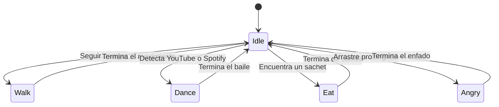

<div align="center">


# 🐈‍⬛ PUDIN.EXE

### `NUEVA ENTIDAD PARANORMAL DETECTADA`

**Un gato fantasma naranja. Tu escritorio. Cero respeto por tu productividad.**

`SECUENCIA DE ARRANQUE COMPLETADA` · `CAT.exe ESTÁ EJECUTÁNDOSE`

[](https://kaledsml.github.io/Pudin-Ghost-Cat-RPA/)

[](#-invocar-al-gato)
[](https://www.python.org/)
[](https://www.pygame.org/)
[](LICENSE)


`ENTITY STATUS: ONLINE` · `CHAOS LEVEL: INESTABLE`

**[▶ VER DEMOSTRACIÓN EN YOUTUBE](https://youtu.be/UMO3PvRJNPc)**

</div>

---

## ⚠️ AVISO DE SEGURIDAD // LEER ANTES DE INVOCAR

Pudin es un experimento de automatización de escritorio con fines lúdicos. Sus bromas pueden interferir con tu trabajo.

**Antes de ejecutarlo, ten en cuenta que puede:**

- Cambiar el fondo de pantalla y no restaurarlo al cerrar.
- Minimizar, mover o sacudir ventanas.
- Abrir el Bloc de notas y escribir automáticamente.
- Abrir YouTube al finalizar una sesión de trabajo.
- Interferir temporalmente con el cursor durante el modo furioso.

**Guarda tu trabajo, cierra documentos importantes y prueba Pudin en un entorno donde una broma no te haga perder nada.** No lo ejecutes durante tareas críticas ni con documentos sin guardar.

El proyecto está diseñado para Windows. Revisa el código antes de ejecutarlo si no confías en sus acciones sobre tu escritorio.

`LA ENTIDAD HA SIDO IDENTIFICADA. LA RESPONSABILIDAD SIGUE SIENDO TUYA.`

---

## ✦ PERFIL DE LA ENTIDAD

Pudin es una pequeña criatura paranormal de escritorio desarrollada con **Python, Pygame y herramientas de Windows**.

Vive en una ventana transparente, flota sobre tus aplicaciones, persigue el cursor y deja rastros de neón. Si detecta YouTube o Spotify, puede ponerse a bailar. Y cuando menos te lo esperas, decide que tu productividad es un problema que debe resolver.

No tiene patas. No las necesita.

Su método de desplazamiento consiste en dejar círculos de gradiente rosa que se desvanecen tras él, como una pequeña anomalía de slime cibernético.

| IDENTIFICACIÓN | REGISTRO |
|---|---|
| Nombre | Pudin |
| Tipo | Gato fantasma / slime paranormal |
| Entorno | Escritorio de Windows |
| Tecnología | Python + Pygame |
| Conducta | Impredecible, pero adorable |
| Nivel de amenaza | Depende de cuánto tengas que entregar |
| Debilidad conocida | Un sachet de comida |

---

## ✦ HABILIDADES DESBLOQUEADAS

### 🐾 01 · Huellas de neón

Pudin sigue el cursor y deja un rastro de partículas y círculos luminosos rosas que desaparecen gradualmente.

### 🪩 02 · Protocolo de baile

Detecta títulos de ventanas relacionados con YouTube o Spotify y puede activar sus animaciones de baile.

### 👻 03 · Motor del caos

A intervalos aproximados de 30 a 90 segundos, puede ejecutar una broma sobre la ventana activa.

La productividad es una sugerencia. El caos es una posibilidad.

### 🍅 04 · Pomodoro gatuno

Alterna sesiones de trabajo de 25 minutos con descansos de 5 minutos. Al finalizar una sesión de trabajo, abre un vídeo de YouTube.

### 🍣 05 · Protocolo del sachet

Dale comida para conseguir una tregua. Si Pudin se come el sachet, obtienes **2 minutos de inmunidad frente a sus bromas**.

No es una solución permanente. Es un contrato temporal.

### 😾 06 · Modo furioso

Si lo arrastras durante más de dos segundos, Pudin puede enfadarse y tomar temporalmente el control del cursor durante unos instantes.

`CONSEJO: NO PROVOQUES A LA ENTIDAD SI TIENES TRABAJO PENDIENTE.`

---

## ✦ INVOCAR AL GATO

`PROTOCOLO DE INSTALACIÓN // WINDOWS`

### Requisitos

- Windows.
- Python 3 instalado.
- Git instalado, o una copia descargada del repositorio.
- Una terminal y una cantidad razonable de paciencia.

Puedes descargar Python desde [python.org](https://www.python.org/downloads/) y Git desde [git-scm.com](https://git-scm.com/downloads).

### 01 · Clona el repositorio

Abre una terminal y ejecuta:

```bash
git clone https://github.com/KaledSML/Pudin-Ghost-Cat-RPA.git
cd Pudin-Ghost-Cat-RPA
```

También puedes descargar el repositorio como ZIP desde GitHub y extraerlo.

### 02 · Crea un entorno virtual

Así las dependencias de Pudin no invaden otros proyectos de Python.

```powershell
py -m venv .venv
```

Actívalo desde PowerShell:

```powershell
.\.venv\Scripts\Activate.ps1
```

Si utilizas el símbolo del sistema (CMD), puedes activarlo con:

```bat
.venv\Scripts\activate.bat
```

### 03 · Instala las dependencias

Desde la carpeta raíz del repositorio, donde está `requirements.txt`:

```bash
python -m pip install --upgrade pip
python -m pip install -r requirements.txt
```

### 04 · Despierta a Pudin

Entra en su guarida y ejecuta el programa:

```bash
cd pudin_cat
python main.py
```

Si todo funciona correctamente, la entidad debería aparecer en tu escritorio.

`BOOT SEQUENCE: COMPLETE`

### 🧯 Si algo sale mal

- **Python no aparece:** comprueba la instalación con `python --version` o `py --version`.
- **No encuentra `requirements.txt`:** vuelve a la carpeta raíz del repositorio antes de instalar las dependencias.
- **No encuentra un archivo de assets:** comprueba que descargaste el repositorio completo y que conservaste su estructura de carpetas.
- **Pudin no se comporta como esperabas:** revisa la consola y los requisitos del proyecto antes de volver a intentarlo.

Los mensajes concretos de error son más útiles que sacrificar otro sachet a la entidad.

---

## ✦ COMPILAR EL EJECUTABLE

`OPCIONAL // GENERAR PUDIN.EXE`

Si quieres empaquetar el programa para ejecutarlo como un `.exe`, puedes utilizar PyInstaller.

Desde la raíz del repositorio, con el entorno virtual activado:

```bash
python -m pip install pyinstaller
cd pudin_cat
```

Después, ejecuta:

```bash
python -m PyInstaller --noconsole --onefile --add-data "assets;assets" --icon "assets/Pudin.ico" --name "Pudin_Ghost_Cat" main.py
```

Si la compilación termina correctamente, el ejecutable se generará dentro de:

```text
pudin_cat/dist/Pudin_Ghost_Cat.exe
```

**Importante:** esta configuración está pensada para Windows. Comprueba que existan `assets/` y `assets/Pudin.ico` antes de compilar. Empaquetar el programa no elimina sus efectos sobre el escritorio: las advertencias de seguridad siguen siendo válidas.

---

## ✦ LABORATORIO DE MALDADES

`MÓDULO EXPERIMENTAL // USAR CON PRECAUCIÓN`

Pudin incluye un script de pruebas para experimentar con sus bromas.

Desde la carpeta que contiene `test_maldades.py`, ejecuta:

```bash
python test_maldades.py
```

Presiona `1` para activar una broma aleatoria.

Deja otra aplicación abierta para observar el resultado y guarda cualquier trabajo importante antes de comenzar.

`TEST SUBJECT: YOUR DESKTOP`

---

## ✦ MANUAL DE SUPERVIVENCIA

`CONOCE A LA ENTIDAD ANTES DE INTERACTUAR`

| Entrada | Efecto |
|---|---|
| `F` / clic derecho | Deja un sachet junto al cursor. Si Pudin se lo come, tendrás 2 minutos sin bromas. |
| Clic izquierdo + arrastrar | Permite levantar y mover a Pudin por el escritorio. |
| Arrastrarlo durante más de 2 segundos | Puede enfadarse y secuestrar el cursor durante 3–5 segundos. |
| `P` | Pausa o reanuda sus actividades. |
| `ESC` | Cierra la aplicación. |

<div align="center">

`EL SACHET SAGRADO`

*La paz es temporal. El gato es eterno.*

</div>

---

## ✦ INFORMES DE INCIDENTES

`ARCHIVO DE EVENTOS // CLASIFICACIÓN: GATUNA`

### 01 · Manipulación de ventanas

Pudin puede ejecutar distintos tipos de bromas sobre la ventana activa:

- **Desaparición:** minimiza la ventana.
- **Terremoto de escritorio:** sacude la ventana repetidamente y después intenta restaurar su posición.
- **Escritor fantasma:** abre el Bloc de notas y escribe una frase automáticamente.

Las bromas se ejecutan en hilos separados para reducir las interrupciones en el bucle principal.

### 02 · Alteración del fondo de pantalla

Pudin puede cambiar el fondo de pantalla al iniciar.

**El fondo original no se restaura automáticamente al cerrar el programa.**

Guarda una copia del fondo que estés usando antes de invocarlo.

### 03 · Escritura involuntaria y aperturas del navegador

Pudin puede escribir en el Bloc de notas y abrir YouTube al finalizar una sesión de trabajo.

Si cambias de aplicación durante una broma, el texto podría introducirse en otra ventana.

Guarda tu trabajo antes de experimentar y evita ejecutar Pudin mientras editas documentos importantes.

### 04 · Arquitectura de comportamiento

Pudin combina estados de animación con comportamientos como seguir el cursor, vagar, bailar, comer o enfadarse.

De forma conceptual, su comportamiento puede representarse así:



Este diagrama es una **representación simplificada del comportamiento**, no una especificación completa de las transiciones internas. La tecla `P` pausa o reanuda las actividades y no debe confundirse con el estado de animación `Sit`.

---

## ✦ DIRECTORIO DEL CÓDIGO FUENTE

`MAPA DE LA GUARIDA // NO ALIMENTAR LOS BUGS`

| Archivo | Función |
|---|---|
| `main.py` | Ventana, bucle principal y controles. |
| `pudin.py` | Estados, comportamiento, Pomodoro y modo troll. |
| `effects.py` | Huellas de neón y partículas. |
| `utils.py` | Utilidades para sonidos, sprites, fondo de pantalla y bromas. |
| `test_maldades.py` | Laboratorio de pruebas. |

Consulta el código fuente para conocer los detalles de implementación y las dependencias utilizadas por cada módulo.

---

## ✦ TRANSMISIONES DESDE EL VACÍO

`ARCHIVO MULTIMEDIA // SEÑAL DETECTADA`

<div align="center">

### ▶ PUDIN EN ACCIÓN

[](https://youtu.be/UMO3PvRJNPc)

**[VER DEMOSTRACIÓN COMPLETA](https://youtu.be/UMO3PvRJNPc)**

[📼 Explorar la playlist de Pudin](https://youtube.com/playlist?list=PL6ic-uQzzKmICgM4mTKT97MxOHBTYgjKb)

</div>

---

## ✦ ARCHIVO CLASIFICADO

`CONTENIDO RESTRINGIDO // SOLO PERSONAL AUTORIZADO`

¿Creías que habías desbloqueado todos los cosméticos de Pudin?

### 🩷 CYBERPUDIN — SKIN EXCLUSIVA

[**✨ RECLAMAR LA SKIN EXCLUSIVA**](https://www.youtube.com/watch?v=dQw4w9WgXcQ)

`DESCARGA INICIADA...`

`ERROR 404: SKIN NO ENCONTRADA`

`REDIRIGIENDO AL DEPARTAMENTO DE ENGAÑOS...`

*ARCHIVO DESCLASIFICADO · PUDIN NO SE HACE RESPONSABLE DE LAS CONSECUENCIAS EMOCIONALES.*

---

## ✦ CRÉDITOS Y TRANSMISIONES

**Creado por [KaledSML](https://github.com/KaledSML)**

Hecho con Python, píxeles y decisiones gatunas cuestionables.

- 🐈‍⬛ [Repositorio](https://github.com/KaledSML/Pudin-Ghost-Cat-RPA)
- 🌐 [Landing page](https://kaledsml.github.io/Pudin-Ghost-Cat-RPA/)
- 📜 [Licencia MIT](LICENSE)
- 🐛 [Reportar un problema](https://github.com/KaledSML/Pudin-Ghost-Cat-RPA/issues)
- 📺 [Demostración en YouTube](https://youtu.be/UMO3PvRJNPc)

Este proyecto se distribuye bajo la licencia MIT. Consulta el archivo `LICENSE` para conocer sus términos.

Si Pudin te hizo el día más extraño, regálale una ⭐ en GitHub.

<div align="center">

`FIN DEL ARCHIVO`

`ENTITY STATUS: STILL ONLINE`

🐾 · 💜 · 👻

**NO ALIMENTAR DESPUÉS DE MEDIANOCHE.**

</div>
