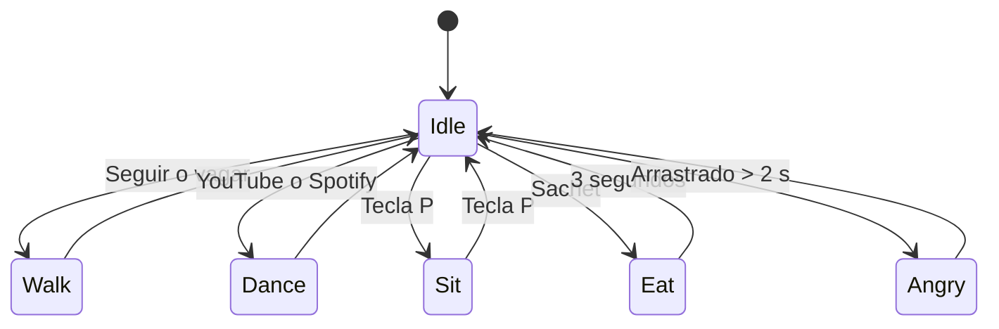

 <div align="center">

# 🐈‍⬛ PUDIN.EXE

### `UNAUTHORIZED DESKTOP ENTITY DETECTED`

*Un pequeño gato fantasma naranja. Una computadora. Cero respeto por tu productividad.*


**`STATUS:`** 🟢 ALIVE & PURRING  
**`THREAT LEVEL:`** 🟣 QUESTIONABLE  
**`SPECIES:`** 👻 DESKTOP GHOST CAT

[](https://youtu.be/UMO3PvRJNPc)

[](https://www.python.org/)
[](#)
[](LICENSE)

`BOOT SEQUENCE COMPLETE` · `CAT.exe IS RUNNING`

</div>

---

> [!CAUTION]
> **ANOMALÍA DETECTADA**
>
> Pudin ha entrado en tu escritorio. Sigue el cursor, deja huellas de neón, baila frente a YouTube y Spotify y, cada cierto tiempo, decide que necesitas un pequeño incidente informático.
>
> No es un asistente virtual. No es productivo. Es naranja.

## ◈ ¿QUÉ ACABAS DE INSTALAR?

Pudin es una pequeña criatura de escritorio desarrollada con **Python, Pygame y herramientas de Windows**. Vive en una ventana transparente, permanece por encima de las demás y hace prácticamente lo que le da la gana.

| 🐾 CAPACIDAD | `SYSTEM REPORT` |
|:--|:--|
| Neon paws | Persigue tu cursor y deja huellas luminosas. |
| Dance protocol | Detecta títulos de ventanas relacionados con YouTube o Spotify y se pone a bailar. |
| Chaos engine | Cada 30 a 90 segundos puede ejecutar una broma sobre la ventana activa. |
| Pomodoro.exe | Alterna 25 minutos de trabajo con 5 minutos de descanso. |
| Snack protocol | Puedes dejarle un sachet para conseguir dos minutos de paz. |
| Ghost mode | Se queda flotando sobre tu escritorio, observándolo todo. |

<details>
<summary><b>👁️ ¿Qué significa exactamente «Chaos engine»?</b></summary>

Pudin tiene tres bromas principales:

- **Window vanish:** minimiza la ventana activa.
- **Desktop earthquake:** sacude la ventana 20 veces, hasta ±25 píxeles, y luego la devuelve a su posición.
- **Ghostwriter:** abre el Bloc de notas, hace clic y escribe una frase automáticamente.

Las bromas se ejecutan en hilos separados para evitar congelar a Pudin y excluyen su propia ventana.

</details>

---

## ◈ SUMMON THE CAT

<div align="center">

`INSTALLATION PROTOCOL // 01`

**Invocar a Pudin requiere Python 3 y Windows.**

</div>

Clona el repositorio, instala las dependencias y ejecuta al pequeño sospechoso.

```bash
git clone https://github.com/KaledSML/Pudin-Ghost-Cat-RPA.git
cd Pudin-Ghost-Cat-RPA/pudin_cat
pip install -r ../requirements.txt
python main.py
```

<details>
<summary><b>📦 Compilar una versión ejecutable (.exe)</b></summary>

Desde la carpeta `pudin_cat`, ejecuta:

```powershell
python -m PyInstaller --noconsole --onefile --add-data "assets;assets" --icon "assets/Pudin.ico" --name "Pudin_Ghost_Cat" main.py
```

El ejecutable se generará en la carpeta `dist`, siempre que la compilación termine correctamente.

</details>

<details>
<summary><b>🧪 Ejecutar el laboratorio de maldades</b></summary>

Desde la carpeta donde está `test_maldades.py`:

```bash
python test_maldades.py
```

Presiona `1` para lanzar una broma aleatoria. Deja otra ventana abierta para observar el resultado.

</details>

---

## ◈ HOW TO HANDLE YOUR ENTITY

`USER MANUAL // INTERACTION LAYER`

| INPUT | EFECTO |
|:--:|:--|
| `F` o clic derecho | Deja un sachet junto al cursor. Si Pudin se lo come, obtienes **2 minutos sin bromas**. 🍣 |
| Clic izquierdo + arrastrar | Puedes moverlo por el escritorio. |
| Arrastrarlo durante más de 2 segundos | Se enfada y secuestra el control del mouse durante 3 a 5 segundos. 😾 |
| `P` | Pausa o reanuda sus actividades. |
| `ESC` | Cierra la aplicación. |

<div align="center">

`TIP: NEVER NEGLECT THE SNACK PROTOCOL`

*La diplomacia felina funciona mejor cuando hay comida de por medio.*

</div>

---

## ◈ KNOWN ANOMALIES

> [!WARNING]
> **LEE ESTO ANTES DE LIBERAR AL GATO.**

- 🖼️ **Wallpaper alteration:** Pudin cambia el fondo de pantalla al iniciar y no lo restaura al cerrar. Guarda una copia del fondo original.
- ⌨️ **Unsolicited typing:** puede escribir en el Bloc de notas. Si cambias de ventana durante una broma, podrías terminar escribiendo en otra aplicación.
- 🌐 **Browser launch:** al terminar una sesión de trabajo del Pomodoro, abre un vídeo de YouTube.
- 🖱️ **Mouse hijacking:** si lo retienes demasiado tiempo, puede tomar el control del cursor brevemente.

Pudin está diseñado para bromear, no para borrar archivos. Aun así, ejecútalo bajo tu propia responsabilidad y guarda tu trabajo antes de experimentar.

---

## ◈ INTERNAL FILE SYSTEM

`ACCESS LEVEL: CURIOUS HUMANS`

<details>
<summary><b>🧠 Máquina de estados de Pudin</b></summary>

Pudin tiene estados y animaciones propias. Cuando coinciden varias acciones, el modo troll tiene prioridad sobre el arrastre, la pausa y la comida. En ausencia de eventos, decide si seguirte, vagar o quedarse quieto.



</details>

<details>
<summary><b>🗂️ Directorio de módulos</b></summary>

| ARCHIVO | FUNCIÓN |
|:--|:--|
| `main.py` | Ventana, bucle principal y controles. |
| `pudin.py` | Estados, comportamiento, Pomodoro y modo troll. |
| `effects.py` | Huellas de neón y partículas. |
| `utils.py` | Sonidos, sprites, fondo de pantalla y bromas. |
| `test_maldades.py` | Laboratorio para probar las bromas. |

</details>

<details>
<summary><b>🪟 ¿Cómo funciona la transparencia?</b></summary>

Pudin utiliza una ventana sin bordes del tamaño del monitor y una clave de color (`255, 0, 128`) que Windows trata como transparente. La ventana se mantiene al frente mediante los estilos de ventana correspondientes. El cursor se consulta con `pyautogui` y la ventana activa con `win32gui`.

</details>

---

## ◈ TRANSMISSIONS FROM THE VOID

<div align="center">

**¿Quieres más pruebas de que este gato existe?**

[▶ Vídeo destacado](https://youtu.be/UMO3PvRJNPc) · [📡 Archivo de transmisiones](https://youtube.com/playlist?list=PL6ic-uQzzKmICgM4mTKT97MxOHBTYgjKb)

</div>

---

## ◈ CREDITS & SURVIVAL NOTES

**Creado por [KaledSML](https://github.com/KaledSML)**

Hecho con Python, experimentos de escritorio y una cantidad cuestionable de cariño gatuno.

- [Repositorio del proyecto](https://github.com/KaledSML/Pudin-Ghost-Cat-RPA)
- [Licencia MIT](LICENSE)
- [Reportar un problema](https://github.com/KaledSML/Pudin-Ghost-Cat-RPA/issues)

<div align="center">

### `END OF FILE`

`PUDIN.EXE // STILL WATCHING YOU`

*Si Pudin te cae bien, déjale una ⭐ en GitHub.*

🐾 💜 🐈‍⬛

</div>
