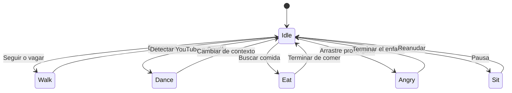

<div align="center">


# PUDIN.EXE

### `UNEXPECTED ENTITY FOUND IN YOUR DESKTOP`

**Un gato fantasma naranja que ha decidido que tu ordenador también es suyo.**

Una mascota de escritorio en Python, animada con Pygame, alimentada por sachets y programada con una preocupante falta de respeto por la productividad.

[🌐 **EXPLORAR LA GUARIDA**](https://kaledsml.github.io/Pudin-Ghost-Cat-RPA/) · [▶ **VER A PUDIN EN ACCIÓN**](https://youtu.be/UMO3PvRJNPc) · [🐈‍⬛ **CÓDIGO FUENTE**](https://github.com/KaledSML/Pudin-Ghost-Cat-RPA)


`SYSTEM STATUS: HAUNTED`  
`ENTITY STATUS: VERY MUCH ONLINE`

</div>

---

> [!CAUTION]
> **Pudin puede modificar tu escritorio.**
>
> Cambia el fondo de pantalla, minimiza y sacude ventanas, mueve el cursor, escribe automáticamente en el Bloc de notas y abre YouTube. Guarda tu trabajo antes de ejecutarlo y no lo utilices durante tareas sensibles. El fondo de pantalla original no se restaura automáticamente.

## ◈ Una presencia inexplicable

Pudin no abre una ventana para quedarse quieto mirando al vacío. Tiene otros planes.

Esta pequeña criatura paranormal vive en una ventana transparente que permanece por encima de las demás aplicaciones. Sigue el cursor, pasea por la pantalla, deja huellas de neón y observa tus hábitos informáticos con una curiosidad que probablemente no aprobaría ningún especialista en ciberseguridad.

¿YouTube abierto? Quizá baile.

¿Spotify en marcha? Quizá también.

¿Llevas demasiado tiempo trabajando? Pudin tiene una solución. No necesariamente la que necesitabas.

Y si lo provocas mientras lo arrastras, puede enfadarse y arrebatarte temporalmente el control del cursor.

**No es un asistente de productividad. Es el motivo por el que necesitas uno.**

## ◈ Capacidades paranormales

<details>
<summary>🐾 <b>Rastros espectrales</b></summary>

Mientras camina, Pudin genera huellas circulares magenta y pequeñas partículas luminosas. Los rastros se desvanecen poco después, dejando una estela de neón sobre el escritorio.
</details>

<details>
<summary>🪩 <b>Detección musical</b></summary>

Pudin busca las palabras `YouTube` y `Spotify` en el título de la ventana activa. Cuando las encuentra, puede activar su animación de baile.
</details>

<details>
<summary>👻 <b>Protocolo de interrupción</b></summary>

Durante el modo de trabajo, Pudin puede ejecutar una de tres bromas sobre la ventana activa:

- Minimizarla.
- Sacudirla durante unos instantes.
- Abrir el Bloc de notas e introducir una frase automáticamente.

Los intentos se programan con intervalos aleatorios de aproximadamente 30 a 90 segundos.
</details>

<details>
<summary>🍅 <b>Pomodoro inverso</b></summary>

Pudin alterna sesiones de trabajo de 25 minutos y descansos de 5 minutos. Al terminar cada sesión de trabajo, abre un vídeo de YouTube.

El temporizador continúa avanzando aunque la mascota esté pausada. Pudin, al parecer, sí respeta el calendario.
</details>

<details>
<summary>🍣 <b>Economía del sachet</b></summary>

Pulsa `F` o haz clic derecho para dejar comida cerca del cursor. Pudin irá hasta ella y empezará a comer cuando llegue.

Después de terminar, aplaza el siguiente intento de broma durante 120 segundos.

La paz tiene un precio. En este caso, viene en un envase pequeño.
</details>

<details>
<summary>😾 <b>Modo furioso</b></summary>

Arrastra a Pudin durante más de dos segundos y puede activar su protocolo de represalia. Durante aproximadamente 3 a 5 segundos, moverá el cursor físicamente y entrará en su estado de enfado.

No es un método recomendado para negociar con la entidad.
</details>

---

## ◈ Primer contacto

### Lo que necesitas

Pudin está diseñado para **Windows** y utiliza APIs propias de ese sistema operativo.

Necesitarás:

- Python 3.
- Las dependencias del proyecto.
- Un entorno Windows con soporte de audio.
- Todos los recursos de la carpeta `pudin_cat/assets/`.

Descarga Python desde [python.org](https://www.python.org/downloads/) si todavía no lo tienes.

### 1. Obtener los archivos

```bash
git clone https://github.com/KaledSML/Pudin-Ghost-Cat-RPA.git
cd Pudin-Ghost-Cat-RPA
```

También puedes descargar el repositorio como ZIP desde GitHub.

### 2. Crear un entorno aislado

En PowerShell:

```powershell
py -m venv .venv
.\.venv\Scripts\Activate.ps1
```

Si utilizas CMD:

```bat
.venv\Scripts\activate.bat
```

### 3. Instalar las dependencias

Desde la raíz del repositorio:

```bash
python -m pip install --upgrade pip
python -m pip install -r requirements.txt
```

El proyecto utiliza:

| Paquete | Propósito |
|---|---|
| `pygame` | Ventana, animaciones, imágenes y audio |
| `pyautogui` | Movimiento del cursor y escritura simulada |
| `pywin32` | Integración con ventanas y APIs de Windows |
| `pyinstaller` | Generación del ejecutable |

### 4. Despertar a la entidad

La estructura del proyecto sitúa el código principal en la raíz y los recursos de la aplicación en `pudin_cat/assets/`. Sin embargo, el código compartido carga los recursos desde una carpeta `assets/` relativa a la ubicación de ejecución.

**Antes de iniciar el programa, comprueba que la carpeta de recursos esté donde la espera `utils.py`.** Si estás usando exactamente la estructura del repositorio que compartiste, puede ser necesario ajustar las rutas de recursos o colocar los archivos Python y `assets/` en una estructura coherente.

Cuando las rutas estén preparadas, ejecuta desde la carpeta que contiene `main.py`:

```bash
python main.py
```

Si todo está correctamente configurado, Pudin aparecerá en tu escritorio.

`BOOT SEQUENCE: COMPLETE` 🐾

---

## ◈ Fabricar una entidad independiente

El repositorio incluye `Pudin_Ghost_Cat.spec`, la configuración de PyInstaller para construir el ejecutable.

Desde la raíz del proyecto, con las dependencias instaladas:

```bash
python -m PyInstaller Pudin_Ghost_Cat.spec
```

La configuración define el nombre `Pudin_Ghost_Cat`, incorpora el icono `assets/Pudin.ico`, empaqueta los recursos desde `assets/` y desactiva la consola.

El archivo `.spec` espera encontrar `main.py` y `assets/` en las ubicaciones configuradas respecto al directorio de compilación. Como la estructura compartida ubica los recursos de la aplicación en `pudin_cat/assets/`, **es necesario alinear las rutas del `.spec` y las del código antes de considerar la compilación lista**.

Tras compilar, revisa el resultado en `dist/` y prueba el ejecutable en Windows. No distribuyas una compilación sin verificar que puede cargar sus imágenes, sonidos y fondo de pantalla.

Un archivo `.exe` no vuelve inofensivas las acciones de Pudin. Solo las empaqueta.

---

## ◈ El laboratorio

El archivo `test_maldades.py` contiene un pequeño panel para lanzar manualmente una broma aleatoria.

Desde la carpeta que contiene el script:

```bash
python test_maldades.py
```

- Pulsa `1` para ejecutar una broma.
- Pulsa `ESC` para cerrar el panel.

Para que la prueba funcione como se espera, Pudin debe estar ejecutándose y su ventana debe poder identificarse correctamente. Guarda tu trabajo antes de probar cualquier acción.

`TEST SUBJECT: YOUR DESKTOP`

---

## ◈ Controles de supervivencia

| Entrada | Acción |
|---|---|
| Clic izquierdo sobre Pudin | Agarrar y arrastrar |
| Arrastrar durante más de 2 segundos | Posible activación del modo furioso |
| Clic derecho | Dejar un sachet |
| `F` | Dejar un sachet |
| `P` | Pausar o reanudar las actividades de la mascota |
| `ESC` | Cerrar la aplicación |

Ten presente que la pausa no detiene necesariamente todos los temporizadores internos.

### El objeto legendario

<div align="center">


### PUDIN'S FINEST

`RAREZA: LEGENDARIA` · `TIPO: CONSUMIBLE`

Aplaza las bromas durante 120 segundos después de que Pudin termina de comer.

*La paz es temporal. El gato es eterno.*

</div>

---

## ◈ Anatomía de la anomalía

El proyecto está dividido en módulos que gestionan distintas partes del comportamiento:

| Archivo | Responsabilidad |
|---|---|
| `main.py` | Inicialización de Pygame, ventana, controles y bucle principal |
| `pudin.py` | Movimiento, animaciones, estados, Pomodoro y modo furioso |
| `effects.py` | Huellas y partículas |
| `utils.py` | Recursos, audio, ventanas de Windows y bromas |
| `test_maldades.py` | Panel manual de pruebas |
| `requirements.txt` | Dependencias de Python |
| `Pudin_Ghost_Cat.spec` | Configuración de PyInstaller |
| `pudin_cat/assets/` | Recursos gráficos y sonoros de la aplicación |
| `docs/` | Landing page y recursos visuales del sitio |

### Ciclo de comportamiento



El diagrama representa estados visibles de forma conceptual. El comportamiento real depende del orden de actualización y de las condiciones internas de cada estado.

---

## ◈ Transmisiones recuperadas

<div align="center">

[](https://youtu.be/UMO3PvRJNPc)

**[▶ VER LA DEMOSTRACIÓN COMPLETA](https://youtu.be/UMO3PvRJNPc)**

[📼 Explorar la playlist](https://youtube.com/playlist?list=PL6ic-uQzzKmICgM4mTKT97MxOHBTYgjKb)

</div>

---

## ◈ Archivo clasificado

<div align="center">

### 🩷 CYBERPUDIN · SKIN EXCLUSIVA

¿Creías que habías desbloqueado todos los cosméticos?

[**✨ RECLAMAR LA SKIN EXCLUSIVA**](https://www.youtube.com/watch?v=dQw4w9WgXcQ)

`DESCARGA INICIADA...`

`ERROR 404: SKIN NO ENCONTRADA`

`REDIRIGIENDO AL DEPARTAMENTO DE ENGAÑOS...`

*Pudin no se hace responsable de las consecuencias emocionales.*

</div>

---

## ◈ Créditos

Creado por **[KaledSML](https://github.com/KaledSML)**.

Hecho con Python, píxeles y decisiones gatunas cuestionables.

- [Repositorio](https://github.com/KaledSML/Pudin-Ghost-Cat-RPA)
- [Landing page](https://kaledsml.github.io/Pudin-Ghost-Cat-RPA/)
- [Reportar un problema](https://github.com/KaledSML/Pudin-Ghost-Cat-RPA/issues)
- [Demostración en YouTube](https://youtu.be/UMO3PvRJNPc)
- [Licencia MIT](LICENSE)

Este proyecto se distribuye bajo la licencia MIT. Consulta el archivo `LICENSE` para conocer sus términos.

<div align="center">

**Si Pudin te hizo el día más extraño, regálale una ⭐ en GitHub.**

`END OF FILE` · `ENTITY STATUS: STILL ONLINE`

🐾 · 💜 · 👻

**NO ALIMENTAR DESPUÉS DE MEDIANOCHE.**

</div>
