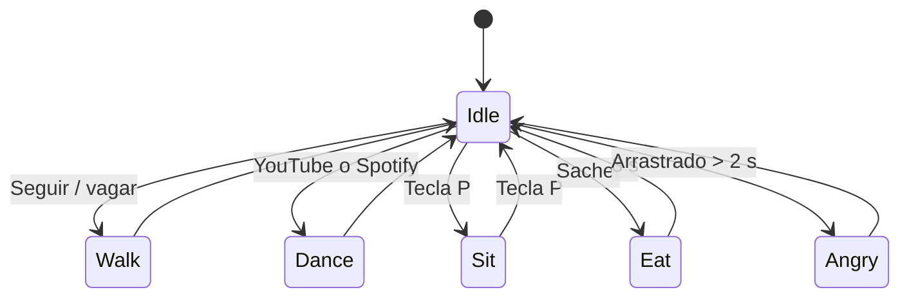

# 🐈‍⬛ PUDIN.EXE // THE GHOST CAT RPA

<p align="center">
  
</p>

<p align="center">
  <strong>AN UNAUTHORIZED FELINE HAS ENTERED YOUR DESKTOP.</strong>
  <br>
  <sub>Entidad naranja detectada · Nivel de amenaza: adorablemente inestable</sub>
</p>

<p align="center">
  <a href="https://youtu.be/UMO3PvRJNPc">
    
  </a>
  <a href="https://github.com/KaledSML/Pudin-Ghost-Cat-RPA">
    
  </a>
</p>

<p align="center">
  
  
  
  
</p>

<p align="center">
  <code>INITIALIZING PURRWARE...</code>
  <br>
  <code>ENTITY STATUS: ACTIVE</code>
  <br>
  <code>HUMAN PRODUCTIVITY: COMPROMISED</code>
</p>

---

## `00 // SYSTEM INDEX`

- [01. Identificación](#01--identificación-del-sujeto)
- [02. Capacidades](#02--capacidades-detectadas)
- [03. Instalación](#03--despliegue-de-la-entidad)
- [04. Controles](#04--interfaz-humano--felino)
- [05. Advertencias](#05--advertencias-de-seguridad)
- [06. Arquitectura](#06--anatomía-del-caos)
- [07. Archivos](#07--mapa-del-sistema)
- [08. Créditos](#08--fin-de-la-transmisión)

---

## `01 // IDENTIFICACIÓN DEL SUJETO`

**Nombre:** Pudin  
**Especie:** Fantasma felino naranja  
**Clasificación:** RPA no convencional  
**Ubicación:** Tu escritorio de Windows  
**Motivación:** Desconocida. Probablemente comida.

Pudin es un pequeño gato de escritorio desarrollado con **Python, Pygame y la API de Windows**. Habita en una ventana transparente que permanece siempre encima de las demás y actúa según sus propios impulsos felinos.

No es un asistente virtual convencional. No optimiza tus tareas ni promete revolucionar tu productividad.

Pudin prefiere observarte, perseguir tu cursor y sabotear tu concentración con una sonrisa invisible.

> **SYSTEM MESSAGE:** La entidad no reconoce la autoridad del usuario.

## `02 // CAPACIDADES DETECTADAS`

<table>
  <tr>
    <td width="50%">
      <strong>🐾 NEON TRACKING</strong><br>
      Persigue el cursor y deja huellas de neón a su paso.
    </td>
    <td width="50%">
      <strong>🕺 AUDIO DETECTION</strong><br>
      Se pone a bailar cuando detecta YouTube o Spotify en el título de la ventana activa.
    </td>
  </tr>
  <tr>
    <td>
      <strong>👻 WINDOW INTERFERENCE</strong><br>
      Ejecuta travesuras cada 30 a 90 segundos sobre la ventana activa.
    </td>
    <td>
      <strong>🍅 POMODORO PROTOCOL</strong><br>
      Alterna 25 minutos de trabajo y 5 de descanso. Al terminar el bloque de trabajo, abre un vídeo de YouTube.
    </td>
  </tr>
  <tr>
    <td>
      <strong>🍘 EDIBLE NEGOTIATION</strong><br>
      Acepta un sachet para suspender sus travesuras durante dos minutos.
    </td>
    <td>
      <strong>😾 MOUSE HIJACK</strong><br>
      Si lo arrastras durante más de dos segundos, puede enfadarse y tomar el control del mouse durante 3 a 5 segundos.
    </td>
  </tr>
</table>

<p align="center">
  <sub>DESARROLLADO POR CURIOSIDAD · MANTENIDO POR RONRONEOS</sub>
</p>

---

## `03 // DESPLIEGUE DE LA ENTIDAD`

### Requisitos

- Windows
- Python 3
- Git

### Instalación

Clona el repositorio y ejecuta a Pudin desde su directorio de trabajo:

```bash
git clone https://github.com/KaledSML/Pudin-Ghost-Cat-RPA.git
cd Pudin-Ghost-Cat-RPA/pudin_cat
pip install -r ../requirements.txt
python main.py
```

**Importante:** ejecuta `main.py` desde la carpeta `pudin_cat` para que la aplicación encuentre correctamente los recursos de `assets/`.

<details>
<summary><strong>📦 COMPILAR // GENERAR EJECUTABLE .EXE</strong></summary>

<br>

Desde la carpeta `pudin_cat`, ejecuta:

```powershell
python -m PyInstaller --noconsole --onefile --add-data "assets;assets" --icon "assets/Pudin.ico" --name "Pudin_Ghost_Cat" main.py
```

Esto genera un ejecutable con PyInstaller. Asegúrate de tener instalado el paquete correspondiente y de que los recursos indicados existan.

</details>

<details>
<summary><strong>🧪 LABORATORIO // PROBAR LAS MALDADES</strong></summary>

<br>

Ejecuta el script de pruebas desde la carpeta `pudin_cat`:

```bash
python test_maldades.py
```

Pulsa `1` para lanzar una travesura aleatoria. Deja otra ventana abierta para observar el resultado.

**Consejo:** guarda tus documentos antes de iniciar los experimentos.

</details>

---

## `04 // INTERFAZ HUMANO ↔ FELINO`

| Entrada | Protocolo ejecutado |
|:---:|---|
| `F` o clic derecho | Deja un sachet junto al cursor. Si Pudin se lo come, suspende las travesuras durante **2 minutos**. 🍘 |
| Clic izquierdo + arrastrar | Permite mover a Pudin. Si lo retienes más de 2 segundos, puede enfadarse y secuestrar el mouse durante **3 a 5 segundos**. 😾 |
| `P` | Pausa o reanuda a Pudin. Mientras está pausado, no ejecuta travesuras. 💤 |
| `ESC` | Cierra la aplicación. 👋 |

<p align="center">
  <code>INPUT RECEIVED // HUMAN AUTHORITY NOT GUARANTEED</code>
</p>

---

## `05 // ADVERTENCIAS DE SEGURIDAD`

> [!WARNING]
> **Pudin no es un virus, pero sí puede interferir con tu escritorio.**
>
> Este proyecto es experimental y algunas de sus funciones interactúan directamente con Windows. Utilízalo sabiendo lo que hace.

### Efectos secundarios conocidos

- **🖼️ Alteración del wallpaper:** Pudin cambia el fondo de pantalla al abrirse y no lo restaura automáticamente al cerrarse. Guarda una copia de tu fondo original.
- **⌨️ Escritura autónoma:** puede abrir el Bloc de notas, hacer clic y escribir una frase. Si cambias de ventana durante la acción, el texto podría terminar en otro lugar.
- **🌐 Apertura del navegador:** al terminar cada bloque de trabajo, abre un vídeo de YouTube.
- **🫨 Interferencia con ventanas:** puede minimizar la ventana activa o sacudirla temporalmente.

Las travesuras se ejecutan en hilos separados y están diseñadas para evitar la ventana de Pudin.

**No ejecutes la aplicación mientras trabajas con información sensible o tareas que no puedas interrumpir.**

<details>
<summary><strong>👁️ AVISO DEL SISTEMA // LEER BAJO TU RESPONSABILIDAD</strong></summary>

<br>

```text
┌──────────────────────────────────────────┐
│          PUDIN.EXE SECURITY LOG          │
├──────────────────────────────────────────┤
│ Entity ............ ORANGE_GHOST_CAT     │
│ Process ........... PURRWARE.EXE         │
│ Status ............ ACTIVE               │
│ Threat level ...... ADORABLE             │
│ Human control ..... QUESTIONABLE         │
└──────────────────────────────────────────┘
```

El chiste de `System32` es solo una broma. Pudin no está diseñado para borrarlo.

**No confundas la estética de caos con una garantía de seguridad.** Revisa el código antes de ejecutar proyectos que interactúan con tu sistema.

</details>

---

## `06 // ANATOMÍA DEL CAOS`

### Máquina de estados

Pudin utiliza una máquina de estados para gestionar sus animaciones y comportamientos. Cuando coinciden varios eventos, las prioridades determinan qué comportamiento se ejecuta.

El modo troll tiene prioridad sobre el arrastre, seguido por la pausa y la comida. En ausencia de eventos, Pudin puede seguirte, vagar o quedarse quieto.



### Módulos de travesuras

| Módulo | Comportamiento |
|---|---|
| 🫥 **Minimizar** | Oculta temporalmente la ventana activa. |
| 🫨 **Sacudir** | Mueve la ventana 20 veces, hasta ±25 píxeles, y después intenta devolverla a su posición original. |
| 👻 **Notepad fantasma** | Abre el Bloc de notas, hace clic y escribe una frase automáticamente. |

### Ventana transparente

Pudin utiliza una ventana sin bordes del tamaño del monitor, configurada para permanecer siempre encima de las demás.

La transparencia se consigue mediante un color clave (`255, 0, 128`) junto con los estilos de ventana de Windows `WS_EX_LAYERED` y las funciones correspondientes de la API.

El seguimiento del cursor utiliza `pyautogui`, mientras que la identificación de la ventana activa utiliza `win32gui`.

---

## `07 // MAPA DEL SISTEMA`

| Archivo | Responsabilidad |
|---|---|
| `main.py` | Ventana, bucle principal y controles. |
| `pudin.py` | Estados, lógica de comportamiento, Pomodoro y modo troll. |
| `effects.py` | Huellas de neón y partículas. |
| `utils.py` | Sonidos, sprites, wallpaper y travesuras. |
| `test_maldades.py` | Laboratorio de pruebas de las travesuras. |

### Tecnologías detectadas

<p>
  
  
  
  
</p>

---

## `08 // FIN DE LA TRANSMISIÓN`

<p align="center">
  <strong>CREATED BY</strong>
  <br>
  <a href="https://github.com/KaledSML">
    
  </a>
</p>

<p align="center">
  <a href="https://github.com/KaledSML/Pudin-Ghost-Cat-RPA">SOURCE CODE</a>
  ·
  <a href="LICENSE">MIT LICENSE</a>
  ·
  <a href="https://youtu.be/UMO3PvRJNPc">WATCH THE ENTITY</a>
</p>

<p align="center">
  Si Pudin te cae bien, regálale una ⭐ en GitHub.
  <br>
  <sub>Hecho con Python, curiosidad y una cantidad cuestionable de caos gatuno.</sub>
</p>

<p align="center">
  <code>END OF TRANSMISSION ♡ PUDIN IS STILL WATCHING.</code>
</p>
