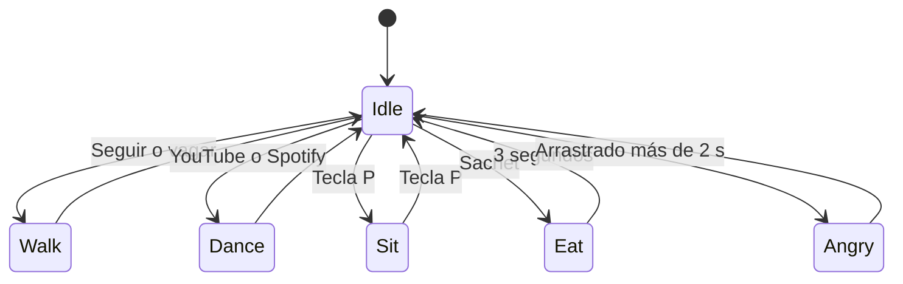

 <div align="center">


# 🐈‍⬛ PUDIN.EXE

### `NUEVA ENTIDAD PARANORMAL DETECTADA`

*Un gato fantasma naranja. Tu escritorio. Cero respeto por tu productividad.*

<br>

<a href="https://kaledsml.github.io/Pudin-Ghost-Cat-RPA/">
  
</a>

<br><br>


<br>


<br><br>

[](https://youtu.be/UMO3PvRJNPc)
[](LICENSE)

`SECUENCIA DE ARRANQUE COMPLETADA` · `CAT.exe ESTÁ EJECUTÁNDOSE`

</div>

---

<table>
<tr>
<td width="58%" valign="top">

## ✦ PERFIL DE LA ENTIDAD

Pudin es una pequeña criatura de escritorio desarrollada con **Python, Pygame y herramientas de Windows**.

Vive en una ventana transparente, flota sobre tus aplicaciones, persigue el cursor y deja pequeñas huellas de neón. Cuando detecta YouTube o Spotify, puede ponerse a bailar.

Y cada cierto tiempo...

**decide que tu productividad es un problema que debe resolver.**

</td>
<td width="42%" valign="middle" align="center">


<sub>FIG. 001 · POSESIÓN DEL ESCRITORIO</sub>

</td>
</tr>
</table>

## ✦ HABILIDADES DESBLOQUEADAS

<table>
<tr>
<td width="50%" valign="top">

### 🐾 Huellas de neón

Sigue el cursor y deja huellas luminosas por el escritorio.

</td>
<td width="50%" valign="top">

### 🪩 Protocolo de baile

Detecta títulos de ventanas relacionados con YouTube o Spotify y se pone a bailar.

</td>
</tr>
<tr>
<td width="50%" valign="top">

### 👻 Motor del caos

Cada 30 a 90 segundos puede ejecutar una broma en la ventana activa.

</td>
<td width="50%" valign="top">

### 🍅 Pomodoro gatuno

Alterna 25 minutos de trabajo con 5 minutos de descanso y abre un vídeo de YouTube al finalizar la sesión de trabajo.

</td>
</tr>
<tr>
<td width="50%" valign="top">

### 🍣 Protocolo del sachet

Déjale comida. Si se la come, tendrás dos minutos de inmunidad frente a sus bromas.

</td>
<td width="50%" valign="top">

### 😾 Modo furioso

Si lo arrastras durante más de dos segundos, puede enfadarse y secuestrar el control del cursor durante unos instantes.

</td>
</tr>
</table>

---

<div align="center">

## ✦ INVOCAR AL GATO

`PROTOCOLO DE INSTALACIÓN // WINDOWS`

</div>

**01 · Clona el repositorio**

```bash
git clone https://github.com/KaledSML/Pudin-Ghost-Cat-RPA.git
```

**02 · Entra en su guarida**

```bash
cd Pudin-Ghost-Cat-RPA/pudin_cat
```

**03 · Instala las dependencias y despiértalo**

```bash
pip install -r ../requirements.txt
python main.py
```

Necesitas **Windows y Python 3**.

<details>
<summary><b>📦 Convertir a un ejecutable (.exe)</b></summary>

Desde la carpeta `pudin_cat`, ejecuta:

```powershell
python -m PyInstaller --noconsole --onefile --add-data "assets;assets" --icon "assets/Pudin.ico" --name "Pudin_Ghost_Cat" main.py
```

Si la compilación termina correctamente, el ejecutable se generará dentro de la carpeta `dist`.

</details>

<details>
<summary><b>🧪 Abrir el laboratorio de maldades</b></summary>

Ejecuta el script desde la carpeta que contiene `test_maldades.py`:

```bash
python test_maldades.py
```

Presiona `1` para activar una broma aleatoria. Deja otra aplicación abierta para observar el resultado.

</details>

---

<div align="center">

## ✦ MANUAL DE SUPERVIVENCIA

`CONOCE A LA ENTIDAD ANTES DE INTERACTUAR`

</div>

<table>
<tr>
<th align="center">ENTRADA</th>
<th align="left">EFECTO</th>
</tr>
<tr>
<td align="center"><code>F</code> / clic derecho</td>
<td>Deja un sachet junto al cursor. Si Pudin se lo come, obtienes <b>2 minutos sin bromas</b>.</td>
</tr>
<tr>
<td align="center">Clic izquierdo + arrastrar</td>
<td>Permite levantar y mover a Pudin por el escritorio.</td>
</tr>
<tr>
<td align="center">Arrastrarlo más de 2 segundos</td>
<td>Se enfada y puede secuestrar el cursor durante 3 a 5 segundos.</td>
</tr>
<tr>
<td align="center"><code>P</code></td>
<td>Pausa o reanuda sus actividades.</td>
</tr>
<tr>
<td align="center"><code>ESC</code></td>
<td>Cierra la aplicación.</td>
</tr>
</table>

<div align="center">


<sub>EL SACHET SAGRADO · LA PAZ ES TEMPORAL</sub>

</div>

---

## ✦ INFORMES DE INCIDENTES

<details>
<summary><b>01 · Manipulación de ventanas</b></summary>

Pudin puede ejecutar tres tipos de bromas en la ventana activa:

- **Desaparición:** minimiza la ventana.
- **Terremoto de escritorio:** sacude la ventana 20 veces, hasta ±25 píxeles, y después restaura su posición.
- **Escritor fantasma:** abre el Bloc de notas, hace clic y escribe una frase automáticamente.

Las bromas se ejecutan en hilos separados para evitar congelar a Pudin y no actúan sobre su propia ventana.

</details>

<details>
<summary><b>02 · Alteración del fondo de pantalla</b></summary>

**Importante:** Pudin cambia el fondo de pantalla al iniciar y no restaura el original al cerrar.

Guarda una copia del fondo que estés usando antes de invocarlo.

</details>

<details>
<summary><b>03 · Escritura involuntaria y aperturas del navegador</b></summary>

Pudin puede escribir en el Bloc de notas y abrir YouTube cuando termina una sesión de trabajo. Si cambias de aplicación durante una broma, el texto podría introducirse en otra ventana.

Guarda tu trabajo antes de experimentar.

</details>

<details>
<summary><b>04 · Máquina de estados interna</b></summary>

Pudin tiene estados y animaciones propios. Cuando coinciden varias acciones, el modo troll tiene prioridad, seguido del arrastre, la pausa y la comida. Si no ocurre nada, periódicamente decide si seguirte, vagar o quedarse quieto.



</details>

<details>
<summary><b>05 · Directorio del código fuente</b></summary>

| ARCHIVO | FUNCIÓN |
|:--|:--|
| `main.py` | Ventana, bucle principal y controles |
| `pudin.py` | Estados, comportamiento, Pomodoro y modo troll |
| `effects.py` | Huellas de neón y partículas |
| `utils.py` | Sonidos, sprites, fondo de pantalla y bromas |
| `test_maldades.py` | Laboratorio de pruebas |

</details>

---
 <div align="center">

## ✦ TRANSMISIONES DESDE EL VACÍO

`ARCHIVO MULTIMEDIA // SEÑAL DETECTADA`

<a href="https://youtu.be/UMO3PvRJNPc">
  
</a>

<sub>▶ HAZ CLIC EN LA MINIATURA PARA VER A PUDIN EN ACCIÓN</sub>

<br><br>

<a href="https://youtube.com/playlist?list=PL6ic-uQzzKmICgM4mTKT97MxOHBTYgjKb">
  
</a>

<br><br>


### `FIN DEL ARCHIVO`

**Creado por [KaledSML](https://github.com/KaledSML)**

Hecho con Python, píxeles y decisiones gatunas cuestionables.

[Repositorio](https://github.com/KaledSML/Pudin-Ghost-Cat-RPA) · [Licencia MIT](LICENSE) · [Reportar un problema](https://github.com/KaledSML/Pudin-Ghost-Cat-RPA/issues)

*Si Pudin te hizo el día más extraño, regálale una ⭐.*

🐾 · 💜 · 👻

</div>
