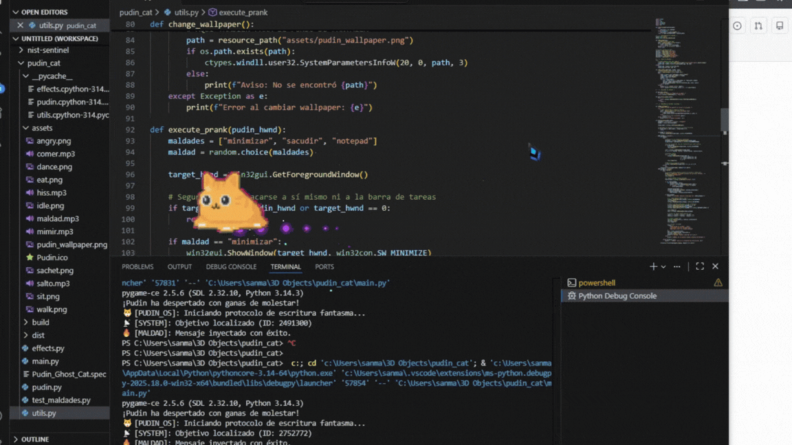
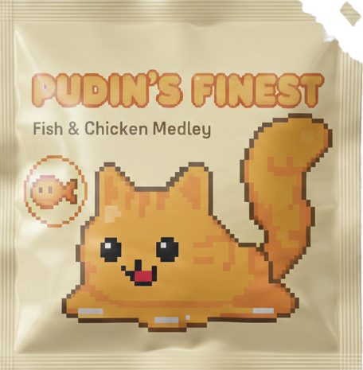
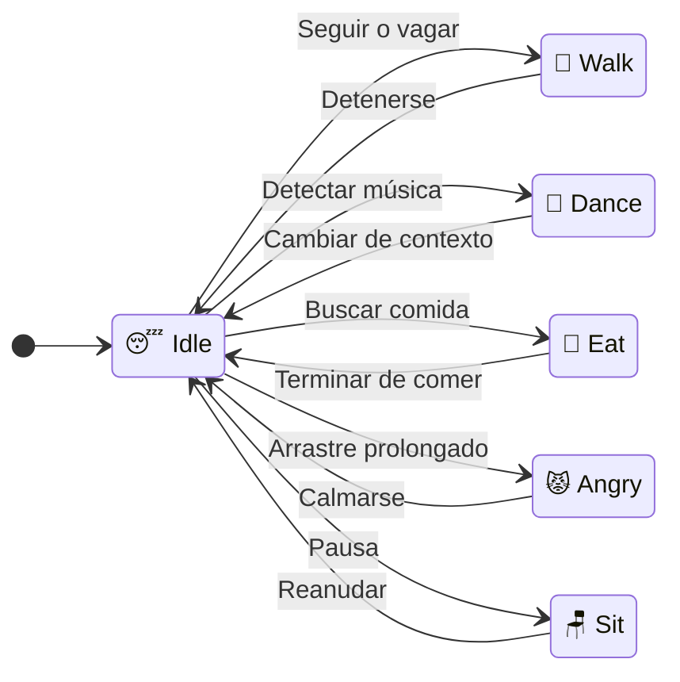

 <div align="center">


# PUDIN.EXE

`UNEXPECTED ENTITY FOUND IN YOUR DESKTOP`

**Un gato fantasma. Tu escritorio. Sus reglas.** 🐈‍⬛

Una mascota en Python que sigue tu cursor, deja huellas de neón y sabotea tu productividad con encanto paranormal.

<a href="https://kaledsml.github.io/Pudin-Ghost-Cat-RPA/"></a>
<a href="https://youtu.be/UMO3PvRJNPc"></a>




`SYSTEM STATUS: HAUNTED` · `ENTITY STATUS: ONLINE`

</div>

---

> [!CAUTION]
> **⚠️ Pudin puede alterar tu escritorio.** Puede mover el cursor, minimizar o sacudir ventanas, escribir automáticamente en el Bloc de notas, cambiar el fondo de pantalla y abrir YouTube. Guarda tu trabajo y evita ejecutarlo durante tareas sensibles. El fondo original no se restaura automáticamente.

## ◈ HABILIDADES PARANORMALES

<table>
<tr>
<td align="center" width="33%">


**🐾 Huellas espectrales**

Huellas magenta y partículas neón.
</td>
<td align="center" width="33%">


**🎵 Detector musical**

¿YouTube o Spotify? ¡A bailar!
</td>
<td align="center" width="33%">


**👻 Motor del caos**

Ventanas inquietas y bromas automáticas.
</td>
</tr>
<tr>
<td align="center">


**🍣 Economía del sachet**

Comida a cambio de 120 segundos de tregua.
</td>
<td align="center">


**🍅 Pomodoro inverso**

25 minutos de trabajo, 5 de descanso y una sorpresa en YouTube.
</td>
<td align="center">


**😾 Modo furioso**

Arrástralo demasiado y podría secuestrar tu cursor durante unos segundos.
</td>
</tr>
</table>

<div align="center">

*No es un asistente de productividad. Es la razón por la que necesitas uno.*

</div>

---

## ◈ DESPERTAR A PUDIN

**Requisitos:** Windows, Python 3 y soporte de audio. 🐈‍⬛

### 01 · Clona el repositorio

```bash
git clone https://github.com/KaledSML/Pudin-Ghost-Cat-RPA.git
cd Pudin-Ghost-Cat-RPA
```

### 02 · Instala las dependencias

```powershell
py -m pip install -r requirements.txt
```

### 03 · Invoca a la entidad

```powershell
cd pudin_cat
python main.py
```

`BOOT SEQUENCE: INITIATED` 🐾


---

## ◈ CONTROLES DE SUPERVIVENCIA

| Entrada | Acción |
|---|---|
| Clic izquierdo + arrastrar | Mover a Pudin |
| Clic derecho o `F` | Dejar un sachet |
| `P` | Pausar o reanudar |
| `ESC` | Cerrar la aplicación |


---
## 🧬 Anatomía de la anomalía

<details>
<summary><strong>📂 Explorar la estructura interna de Pudin</strong></summary>

<br>

> **ARCHIVO CLASIFICADO · PUDIN PROJECT**
>
> Un mapa de los componentes responsables del comportamiento de la criatura.

### 🗂️ Módulos del sistema

| Archivo o directorio | Descripción |
|:--|:--|
| `main.py` | 🖥️ Ventana, controles y bucle principal |
| `pudin.py` | 🐈 Movimiento, animaciones y comportamiento |
| `effects.py` | ✨ Huellas, partículas y efectos visuales |
| `utils.py` | 🔊 Recursos, audio, ventanas y bromas |
| `test_maldades.py` | 🧪 Panel de experimentación manual |
| `requirements.txt` | 📦 Dependencias de Python |
| `Pudin_Ghost_Cat.spec` | ⚙️ Configuración del ejecutable |
| `pudin_cat/assets/` | 🎨 Recursos gráficos y sonoros |
| `docs/` | 🌐 Landing page y recursos web |

### 🔄 Ciclo de comportamiento

El sujeto alterna entre distintos estados según su entorno, sus necesidades y el nivel de provocación recibido.



<sub>STATUS: OPERATIONAL · BEHAVIORAL ROUTINES MAPPED</sub>

</details>

---

## ⚙️ Fabricación del ejecutable

<details>
<summary><strong>🔧 Protocolo de compilación · PyInstaller</strong></summary>

<br>

El repositorio incluye el archivo `Pudin_Ghost_Cat.spec`, encargado de definir la configuración de compilación del ejecutable.

**Antes de iniciar el procedimiento**, comprueba que las rutas de `main.py`, `utils.py`, los recursos gráficos y sonoros, y el archivo `.spec` coincidan con la estructura real del proyecto.

### 🛠️ Iniciar la compilación

Ejecuta el siguiente comando desde el directorio raíz del repositorio:

```bash
python -m PyInstaller Pudin_Ghost_Cat.spec
```

### 📋 Registro del procedimiento

- **Herramienta:** PyInstaller
- **Archivo de configuración:** `Pudin_Ghost_Cat.spec`
- **Punto de partida:** directorio raíz del proyecto

<sub>BUILD STATUS: PENDING VERIFICATION</sub>

</details>

---

## 🧪 El laboratorio de pruebas

<details>
<summary><strong>☣️ Abrir el panel de experimentación manual</strong></summary>

<br>

> **TEST SUBJECT: YOUR DESKTOP**
>
> El siguiente procedimiento permite activar manualmente una de las bromas de Pudin.

### ▶️ Inicializar el laboratorio

```bash
python test_maldades.py
```

### 🎮 Controles del experimento

| Tecla | Acción |
|:--|:--|
| `1` | 💥 Ejecutar una broma |
| `ESC` | 🚪 Cerrar el panel de pruebas |

### ⚠️ Protocolo de seguridad

Pudin debe estar ejecutándose para que el panel pueda identificar su ventana correctamente.

**Guarda tu trabajo antes de comenzar.** Algunas pruebas pueden interferir con tu escritorio.

<sub>EXPERIMENT STATUS: MANUAL CONTROL ENABLED</sub>

</details>

---


---

<sub>🐈‍⬛ **PUDIN GHOST CAT** · Internal Documentation</sub>

<sub>Made with 💜 by [@KaledSML](https://github.com/KaledSML)</sub>

<sub>¿Pudin te sacó una sonrisa? Déjale una ⭐ en GitHub.</sub>

