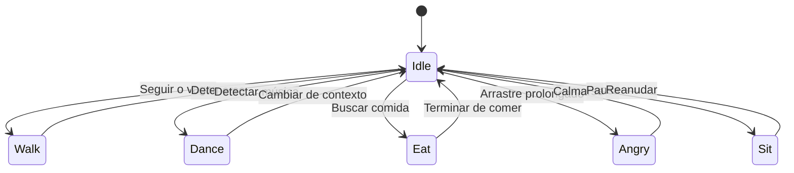

 <div align="center">


# PUDIN.EXE

`UNEXPECTED ENTITY FOUND IN YOUR DESKTOP`

**Un gato fantasma. Tu escritorio. Sus reglas.** 🐈‍⬛

Una mascota en Python que sigue tu cursor, deja huellas de neón y sabotea tu productividad con encanto paranormal.

<a href="https://kaledsml.github.io/Pudin-Ghost-Cat-RPA/"></a>
<a href="https://youtu.be/UMO3PvRJNPc"></a>


`SYSTEM STATUS: HAUNTED` · `ENTITY STATUS: ONLINE`

</div>

---

> [!CAUTION]
> **⚠️ Pudin puede alterar tu escritorio.** Puede mover el cursor, minimizar o sacudir ventanas, escribir automáticamente en el Bloc de notas, cambiar el fondo de pantalla y abrir YouTube. Guarda tu trabajo y evita ejecutarlo durante tareas sensibles. El fondo original no se restaura automáticamente.

## ◈ HABILIDADES PARANORMALES

<table>
<tr>
<td align="center" width="33%">


**🐾 Huellas espectrales**

Huellas magenta y partículas neón.
</td>
<td align="center" width="33%">


**🎵 Detector musical**

¿YouTube o Spotify? ¡A bailar!
</td>
<td align="center" width="33%">


**👻 Motor del caos**

Ventanas inquietas y bromas automáticas.
</td>
</tr>
<tr>
<td align="center">


**🍣 Economía del sachet**

Comida a cambio de 120 segundos de tregua.
</td>
<td align="center">


**🍅 Pomodoro inverso**

25 minutos de trabajo, 5 de descanso y una sorpresa en YouTube.
</td>
<td align="center">


**😾 Modo furioso**

Arrástralo demasiado y podría secuestrar tu cursor durante unos segundos.
</td>
</tr>
</table>

<div align="center">

*No es un asistente de productividad. Es la razón por la que necesitas uno.*

</div>

---

## ◈ DESPERTAR A PUDIN

**Requisitos:** Windows, Python 3 y soporte de audio. 🐈‍⬛

### 01 · Clona el repositorio

```bash
git clone https://github.com/KaledSML/Pudin-Ghost-Cat-RPA.git
cd Pudin-Ghost-Cat-RPA
```

### 02 · Instala las dependencias

```powershell
py -m pip install -r requirements.txt
```

### 03 · Invoca a la entidad

```powershell
cd pudin_cat
python main.py
```

`BOOT SEQUENCE: INITIATED` 🐾

> **Nota:** ejecuta el programa desde `pudin_cat/`, donde se encuentran los archivos de la aplicación y la carpeta `assets/`. La ejecución y la compilación dependen de que las rutas de recursos estén configuradas correctamente.


---

## ◈ CONTROLES DE SUPERVIVENCIA

| Entrada | Acción |
|---|---|
| Clic izquierdo + arrastrar | Mover a Pudin |
| Clic derecho o `F` | Dejar un sachet |
| `P` | Pausar o reanudar |
| `ESC` | Cerrar la aplicación |

La pausa no detiene necesariamente todos los temporizadores internos.

---

<details>
<summary><strong>🧬 Anatomía de la anomalía</strong></summary>

| Archivo o carpeta | Función |
|---|---|
| `main.py` | Ventana, controles y bucle principal |
| `pudin.py` | Movimiento, animaciones y comportamiento |
| `effects.py` | Huellas y partículas |
| `utils.py` | Recursos, audio, ventanas y bromas |
| `test_maldades.py` | Panel de pruebas manuales |
| `requirements.txt` | Dependencias de Python |
| `Pudin_Ghost_Cat.spec` | Configuración de PyInstaller |
| `pudin_cat/assets/` | Recursos gráficos y sonoros |
| `docs/` | Landing page y recursos del sitio |

### Ciclo de comportamiento



</details>

<details>
<summary><strong>⚙️ Fabricar el ejecutable</strong></summary>

El repositorio incluye `Pudin_Ghost_Cat.spec`.

Cuando las rutas de `main.py`, `utils.py`, los recursos y el archivo `.spec` estén alineadas, puedes intentar compilar con:

```bash
python -m PyInstaller Pudin_Ghost_Cat.spec
```

La configuración actual espera encontrar `main.py` y los recursos en ubicaciones concretas. Comprueba las rutas y revisa el resultado en `dist/`. Después, prueba el ejecutable en Windows para verificar que carga correctamente las imágenes, los sonidos y el fondo de pantalla.

**Un `.exe` no neutraliza las acciones de Pudin. Solo las empaqueta.**

</details>

<details>
<summary><strong>🧪 El laboratorio de pruebas</strong></summary>

`test_maldades.py` contiene un panel para lanzar una broma manualmente.

```bash
python test_maldades.py
```

- Pulsa `1` para ejecutar una broma.
- Pulsa `ESC` para cerrar el panel.

Pudin debe estar ejecutándose para que el panel pueda identificar su ventana correctamente. Guarda tu trabajo antes de probarlo.

`TEST SUBJECT: YOUR DESKTOP`

</details>

<details>
<summary><strong>💿 Archivo clasificado: skin secreta</strong></summary>

<div align="center">

### 🩷 CYBERPUDIN

¿Creías que habías desbloqueado todos los cosméticos?

[✨ Reclamar la skin exclusiva](https://www.youtube.com/watch?v=dQw4w9WgXcQ)

`ERROR 404: SKIN NO ENCONTRADA`

`REDIRIGIENDO AL DEPARTAMENTO DE ENGAÑOS...`

</div>

</details>

---

<div align="center">

**Made with 💜 by [@KaledSML](https://github.com/KaledSML)**

Si Pudin te sacó una sonrisa, déjale una ⭐ en [GitHub](https://github.com/KaledSML/Pudin-Ghost-Cat-RPA).

`THANKS FOR FEEDING THE CAT` 🐾

`END OF FILE · ENTITY STATUS: STILL ONLINE`

</div>
