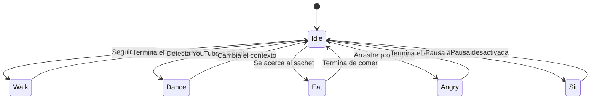

 <div align="center">


# 🐈‍⬛ PUDIN.EXE

### `NUEVA ENTIDAD PARANORMAL DETECTADA`

**Un gato fantasma naranja. Tu escritorio. Cero respeto por tu productividad.**

`SECUENCIA DE ARRANQUE COMPLETADA` · `CAT.exe ESTÁ EJECUTÁNDOSE`

[](https://kaledsml.github.io/Pudin-Ghost-Cat-RPA/)

[](#-invocar-al-gato) [](https://www.python.org/) [](https://www.pygame.org/) [](LICENSE)


`ENTITY STATUS: ONLINE` · `CHAOS LEVEL: INESTABLE`

**[▶ VER DEMOSTRACIÓN](https://youtu.be/UMO3PvRJNPc)**

</div>

---

## ⚠️ AVISO DE SEGURIDAD // LEER ANTES DE INVOCAR

> [!WARNING]
> Pudin no es solo una mascota animada. Puede cambiar configuraciones del escritorio, manipular ventanas, mover el cursor y escribir texto automáticamente. **Guarda tu trabajo antes de ejecutarlo.**

Entre sus comportamientos se incluyen:

- Cambiar el fondo de pantalla de Windows. No lo restaura automáticamente al cerrar.
- Minimizar o sacudir la ventana que esté activa.
- Abrir el Bloc de notas y escribir una frase mediante simulación de teclado.
- Mover físicamente el cursor durante el modo furioso.
- Abrir YouTube al terminar una sesión de trabajo de 25 minutos.
- Interferir con la ventana que tengas en primer plano durante una broma.

No lo ejecutes mientras trabajas con documentos importantes, haces operaciones sensibles o utilizas aplicaciones críticas. Durante la escritura automática, cambiar de ventana puede provocar que el texto termine en una aplicación distinta.

`LA ENTIDAD HA SIDO IDENTIFICADA. LA RESPONSABILIDAD SIGUE SIENDO TUYA.`

---

## ✦ 01 // PERFIL DE LA ENTIDAD

Pudin es una pequeña criatura paranormal de escritorio creada con **Python, Pygame y herramientas de Windows**. Habita una ventana sin bordes y con transparencia, flota sobre tus aplicaciones, persigue el cursor y deja huellas de neón.

Si detecta `YouTube` o `Spotify` en el título de la ventana activa, puede ponerse a bailar. Si le ofreces comida, irá a buscarla. Y si lo arrastras demasiado tiempo, quizá decida que ahora **él** controla el ratón.

**No tiene patas. No las necesita.**

<div align="center">

| IDENTIFICACIÓN | REGISTRO |
|:--|:--|
| **Nombre** | Pudin |
| **Especie** | Gato fantasma / slime paranormal |
| **Hábitat** | Escritorio de Windows |
| **Tecnología** | Python · Pygame · PyWin32 |
| **Personalidad** | Impredecible, pero adorable |
| **Nivel de amenaza** | Proporcional a tus tareas pendientes |
| **Debilidad conocida** | Un sachet de comida |

</div>

## ✦ 02 // HABILIDADES DETECTADAS

<details open>
<summary><b>🐾 01 · Huellas de neón</b></summary>

Pudin deja círculos rosas y pequeñas partículas mientras camina. Las huellas se desvanecen con el tiempo y cambian de tamaño según la escala de la mascota.

</details>

<details open>
<summary><b>🪩 02 · Protocolo de baile</b></summary>

Cuando el título de la ventana activa contiene `YouTube` o `Spotify`, Pudin puede activar su animación de baile.

</details>

<details open>
<summary><b>👻 03 · Motor del caos</b></summary>

Mientras está trabajando, puede lanzar una broma sobre la ventana activa. El intervalo habitual entre intentos es de aproximadamente **30 a 90 segundos**. Las bromas disponibles son minimizar una ventana, sacudirla o iniciar una secuencia de escritura automática en el Bloc de notas.

</details>

<details open>
<summary><b>🍅 04 · Pomodoro gatuno</b></summary>

Pudin alterna entre **25 minutos de trabajo** y **5 minutos de descanso**. Al terminar el periodo de trabajo, abre un vídeo de YouTube. El temporizador sigue avanzando aunque actives la pausa de la mascota.

</details>

<details open>
<summary><b>🍣 05 · Protocolo del sachet</b></summary>

Haz clic derecho o pulsa `F` para dejar comida cerca del cursor. Pudin caminará hasta ella y se la comerá. Cuando termina de comer, aplaza el siguiente intento de broma durante **120 segundos**.

No es una solución permanente. Es un contrato temporal.

</details>

<details open>
<summary><b>😾 06 · Modo furioso</b></summary>

Si mantienes a Pudin arrastrado durante más de dos segundos, puede enfadarse y tomar temporalmente el control del cursor durante unos **3 a 5 segundos**.

</details>

---

## ✦ 03 // MANUAL DE SUPERVIVENCIA

`ENTRADAS DETECTADAS // INTERACTÚA BAJO TU PROPIO RIESGO`

| Entrada | Efecto |
|:--|:--|
| Clic izquierdo sobre Pudin | Empieza a arrastrarlo. |
| Mantener el arrastre más de 2 segundos | Puede activar el modo furioso. |
| Clic derecho | Deja un sachet junto al cursor. |
| `F` | Deja un sachet junto al cursor. |
| `P` | Alterna la pausa de la mascota. |
| `ESC` | Cierra la aplicación. |

**Consejo:** si necesitas recuperar el control rápidamente, pulsa `ESC` para cerrar la aplicación. Recuerda que el fondo de pantalla cambiado por Pudin no se restaura automáticamente.

<div align="center">


### 🍣 PUDIN'S FINEST

`RAREZA: LEGENDARIA` · `TIPO: CONSUMIBLE`

**Efecto:** aplaza las bromas durante 120 segundos después de que Pudin termina de comer.

*La paz es temporal. El gato es eterno.*

</div>

---

## ✦ 04 // INVOCAR AL GATO

`PROTOCOLO DE INSTALACIÓN // WINDOWS`

### Requisitos

- Windows.
- Python 3 instalado.
- Git instalado, o una copia descargada del repositorio.
- Audio habilitado para reproducir los efectos de sonido.

Descargas oficiales: [Python](https://www.python.org/downloads/) · [Git](https://git-scm.com/downloads)

### 01 · Obtén el repositorio

```bash
git clone https://github.com/KaledSML/Pudin-Ghost-Cat-RPA.git
cd Pudin-Ghost-Cat-RPA
```

También puedes descargar el repositorio como ZIP desde GitHub y extraerlo.

### 02 · Crea un entorno virtual

En PowerShell:

```powershell
py -m venv .venv
.\.venv\Scripts\Activate.ps1
```

Si utilizas CMD:

```bat
.venv\Scripts\activate.bat
```

### 03 · Instala las dependencias

Desde la raíz del repositorio, donde está `requirements.txt`:

```bash
python -m pip install --upgrade pip
python -m pip install -r requirements.txt
```

Las dependencias principales son:

- `pygame`: ventana, animaciones, sprites y sonidos.
- `pyautogui`: interacción con el cursor y simulación de teclado.
- `pywin32`: integración con ventanas y funciones de Windows.
- `pyinstaller`: creación del ejecutable.

### 04 · Despierta a Pudin

Si `main.py` está en la raíz del repositorio, ejecuta:

```bash
python main.py
```

Si los archivos Python están dentro de `pudin_cat/`, entra primero en esa carpeta:

```bash
cd pudin_cat
python main.py
```

**Importante:** conserva la carpeta `assets/` junto a la aplicación según la estructura de recursos que utiliza el código. Debe incluir los sprites, sonidos, el sachet y el fondo de pantalla.

---

## ✦ 05 // COMPILAR EL EJECUTABLE

`OPCIONAL // GENERAR PUDIN_GHOST_CAT.EXE`

El repositorio incluye `Pudin_Ghost_Cat.spec`, un archivo de configuración para PyInstaller. Utilizarlo ayuda a mantener la compilación alineada con las opciones del proyecto.

Desde la carpeta que contiene el archivo `.spec` y `main.py`, con las dependencias instaladas:

```bash
python -m PyInstaller Pudin_Ghost_Cat.spec
```

La configuración actual define el nombre `Pudin_Ghost_Cat`, usa el icono `assets/Pudin.ico`, incluye `assets/` como datos y desactiva la consola.

La ruta del ejecutable depende de la configuración de PyInstaller; normalmente aparecerá en una carpeta `dist/`.

Antes de distribuirlo, prueba el `.exe` en un entorno Windows limpio y verifica que encuentre todos los recursos. **Empaquetar el programa no elimina sus efectos sobre el escritorio.**

---

## ✦ 06 // LABORATORIO DE MALDADES

`MÓDULO EXPERIMENTAL // USAR CON PRECAUCIÓN`

El archivo `test_maldades.py` abre una pequeña ventana de laboratorio para activar manualmente una broma aleatoria.

Desde la carpeta donde se encuentra el script:

```bash
python test_maldades.py
```

- Pulsa `1` para lanzar una broma aleatoria.
- Pulsa `ESC` para cerrar el laboratorio.

Para obtener el comportamiento esperado, ejecuta el laboratorio con las dependencias instaladas y comprueba que el identificador de la ventana de Pudin se detecte correctamente. Guarda tu trabajo antes de probarlo: este laboratorio no es una simulación inocua.

---

## ✦ 07 // INFORMES DE INCIDENTES

### Manipulación de ventanas

Pudin puede minimizar la ventana activa, sacudirla durante unos instantes o abrir el Bloc de notas y escribir una frase. La acción se elige aleatoriamente y puede afectar a la ventana que esté en primer plano.

### Alteración del fondo de pantalla

Al iniciar, Pudin intenta cambiar el fondo de pantalla de Windows por `assets/pudin_wallpaper.png`. El fondo anterior **no se restaura automáticamente** al salir.

### Cursor fuera de control

En el modo furioso, Pudin mueve el cursor mediante PyAutoGUI durante unos segundos. Evita activarlo cuando estés trabajando con datos importantes o realizando acciones sensibles.

### Arquitectura de comportamiento

El siguiente esquema resume algunos estados visibles. Es conceptual y no representa todas las interacciones internas del programa.



La tecla `P` activa una pausa parcial de la mascota. No detiene necesariamente todos los temporizadores internos.

---

## ✦ 08 // MAPA DE LA GUARIDA

`DIRECTORIO DEL CÓDIGO FUENTE // NO ALIMENTAR LOS BUGS`

| Archivo | Función |
|:--|:--|
| `main.py` | Inicialización de Pygame, ventana, controles y bucle principal. |
| `pudin.py` | Estados, movimiento, Pomodoro, comida y modo furioso. |
| `effects.py` | Huellas de neón y partículas. |
| `utils.py` | Sonidos, sprites, fondo de pantalla y bromas de Windows. |
| `test_maldades.py` | Panel manual para probar bromas. |
| `requirements.txt` | Dependencias de Python. |
| `Pudin_Ghost_Cat.spec` | Configuración de PyInstaller. |
| `assets/` | Sprites, sonidos, icono y otros recursos de la aplicación. |
| `docs/` | Landing page y recursos gráficos del sitio. |

---

## ✦ 09 // TRANSMISIONES DESDE EL VACÍO

<div align="center">

### ▶ PUDIN EN ACCIÓN

[](https://youtu.be/UMO3PvRJNPc)

**[▶ VER DEMOSTRACIÓN COMPLETA](https://youtu.be/UMO3PvRJNPc)**

[📼 Explorar la playlist de Pudin](https://youtube.com/playlist?list=PL6ic-uQ
