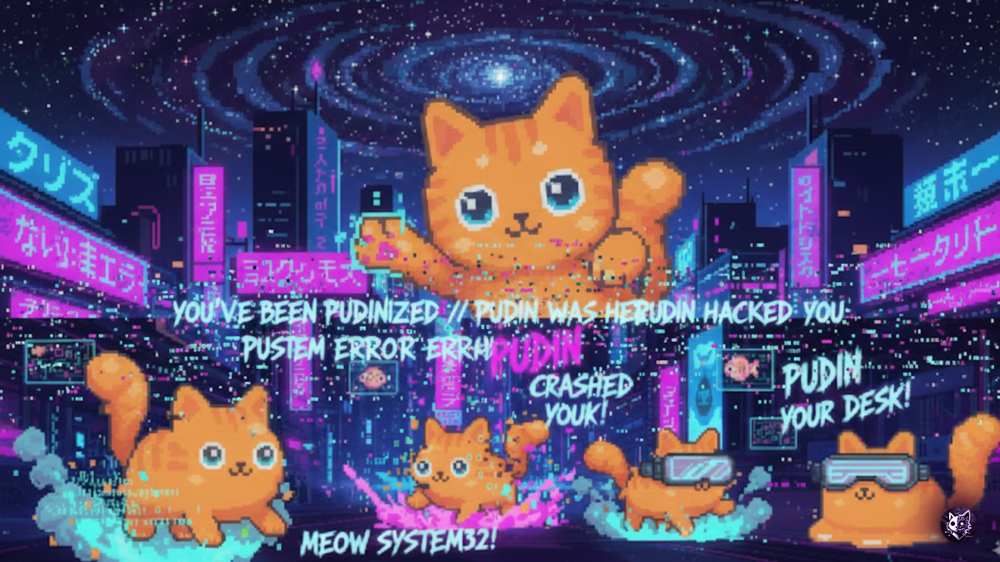

 <div align="center">


# 🐈 PUDIN.EXE

### `YOUR DESKTOP HAS A NEW PARANORMAL RESIDENT`

*Un gato fantasma naranja con acceso a tu escritorio y cero respeto por tu productividad.*


<br>


<br><br>

[](https://youtu.be/UMO3PvRJNPc)
[](LICENSE)

`BOOT SEQUENCE COMPLETE` · `CAT.exe IS RUNNING`

</div>

---

<table>
<tr>
<td width="58%" valign="top">

## ✦ ENTITY PROFILE

Pudin es una pequeña criatura de escritorio creada con **Python, Pygame y herramientas de Windows**.

Vive en una ventana transparente, flota sobre tus aplicaciones, persigue el cursor y deja pequeñas huellas de neón. Cuando detecta YouTube o Spotify, puede ponerse a bailar.

Y cada cierto tiempo...

**decide que tu productividad es un problema que debe resolver.**

</td>
<td width="42%" valign="middle" align="center">



<sub>FIG. 001 · DESKTOP POSSESSION</sub>

</td>
</tr>
</table>

## ✦ CAPABILITIES UNLOCKED

<table>
<tr>
<td width="50%" valign="top">

### 🐾 NEON PAWS

Sigue el cursor y deja huellas luminosas por el escritorio.

</td>
<td width="50%" valign="top">

### 🎵 DANCE PROTOCOL

Detecta títulos de ventanas relacionados con YouTube o Spotify y se pone a bailar.

</td>
</tr>
<tr>
<td width="50%" valign="top">

### 👻 CHAOS ENGINE

Cada 30 a 90 segundos puede ejecutar una broma en la ventana activa.

</td>
<td width="50%" valign="top">

### 🍅 POMODORO CAT

Alterna 25 minutos de trabajo con 5 minutos de descanso y abre un vídeo de YouTube al finalizar el bloque de trabajo.

</td>
</tr>
<tr>
<td width="50%" valign="top">

### 🍣 SNACK PROTOCOL

Déjale un sachet. Si se lo come, tendrás dos minutos de inmunidad frente a sus bromas.

</td>
<td width="50%" valign="top">

### 😾 ANGER MODE

Si lo arrastras durante más de dos segundos, puede enfadarse y secuestrar el control del cursor brevemente.

</td>
</tr>
</table>

---

<div align="center">

## ✦ SUMMON YOUR CAT

`INSTALLATION PROTOCOL // WINDOWS`

</div>

**01 · Clone the repository**

```bash
git clone https://github.com/KaledSML/Pudin-Ghost-Cat-RPA.git
```

**02 · Enter the lair**

```bash
cd Pudin-Ghost-Cat-RPA/pudin_cat
```

**03 · Install dependencies and awaken Pudin**

```bash
pip install -r ../requirements.txt
python main.py
```

<details>
<summary><b>📦 Compile Pudin into an executable (.exe)</b></summary>

From the `pudin_cat` directory, run:

```powershell
python -m PyInstaller --noconsole --onefile --add-data "assets;assets" --icon "assets/Pudin.ico" --name "Pudin_Ghost_Cat" main.py
```

The executable should be generated inside the `dist` directory if the build completes successfully.

</details>

<details>
<summary><b>🧪 Open the Chaos Laboratory</b></summary>

Run the test script from the directory containing `test_maldades.py`:

```bash
python test_maldades.py
```

Press `1` to trigger a random prank. Keep another application window open to observe the result.

</details>

---

<div align="center">

## ✦ SURVIVAL GUIDE

`KNOW YOUR ENTITY BEFORE INTERACTING`

</div>

<table>
<tr>
<th align="center">INPUT</th>
<th align="left">ACTION</th>
</tr>
<tr>
<td align="center"><code>F</code> / Right-click</td>
<td>Place a sachet near your cursor. If Pudin eats it, enjoy <b>2 minutes without pranks</b>.</td>
</tr>
<tr>
<td align="center">Left-click + drag</td>
<td>Pick up and move Pudin around the desktop.</td>
</tr>
<tr>
<td align="center">Hold for over 2 seconds</td>
<td>Anger him, and he may hijack your mouse for 3 to 5 seconds.</td>
</tr>
<tr>
<td align="center"><code>P</code></td>
<td>Pause or resume Pudin's activities.</td>
</tr>
<tr>
<td align="center"><code>ESC</code></td>
<td>Close the application.</td>
</tr>
</table>

<div align="center">


<sub>THE SACRED SNACK · PEACE IS TEMPORARY</sub>

</div>

---

## ✦ INCIDENT REPORTS

<details>
<summary><b>01 · Window manipulation</b></summary>

Pudin can perform three types of pranks on the active window:

- **Window vanish:** minimizes the active window.
- **Desktop earthquake:** shakes the window 20 times by up to ±25 pixels, then restores its position.
- **Ghostwriter:** opens Notepad, clicks and types a phrase automatically.

The pranks run in separate threads and avoid Pudin's own window.

</details>

<details>
<summary><b>02 · Wallpaper alteration</b></summary>

**Important:** Pudin changes your desktop wallpaper when the application starts and does not restore the original when it closes.

Save a copy of your current wallpaper before launching him.

</details>

<details>
<summary><b>03 · Unsolicited typing and browser launches</b></summary>

Pudin can type in Notepad and open YouTube when a work session ends. If you switch applications during a prank, text could be entered in a different window.

Save your work before experimenting.

</details>

<details>
<summary><b>04 · Internal state machine</b></summary>

Pudin has individual states and animations. When multiple actions overlap, troll mode takes priority, followed by dragging, pausing and eating. When nothing is happening, he periodically chooses to follow you, wander or remain idle.


</details>

<details>
<summary><b>05 · Source code directory</b></summary>

| FILE | PURPOSE |
|:--|:--|
| `main.py` | Window, main loop and controls |
| `pudin.py` | States, behavior, Pomodoro and troll mode |
| `effects.py` | Neon pawprints and particles |
| `utils.py` | Sounds, sprites, wallpaper and pranks |
| `test_maldades.py` | Prank testing laboratory |

</details>

---

<div align="center">

## ✦ TRANSMISSIONS FROM THE VOID

[](https://youtu.be/UMO3PvRJNPc)

[Open the transmission archive](https://youtube.com/playlist?list=PL6ic-uQzzKmICgM4mTKT97MxOHBTYgjKb)

<br>


### `END OF FILE`

**Created by [KaledSML](https://github.com/KaledSML)**

Made with Python, pixels and questionable feline decisions.

[Repository](https://github.com/KaledSML/Pudin-Ghost-Cat-RPA) · [MIT License](LICENSE) · [Report an issue](https://github.com/KaledSML/Pudin-Ghost-Cat-RPA/issues)

*If Pudin made your day stranger, leave him a ⭐.*

🐾 · 💜 · 👻

</div>
