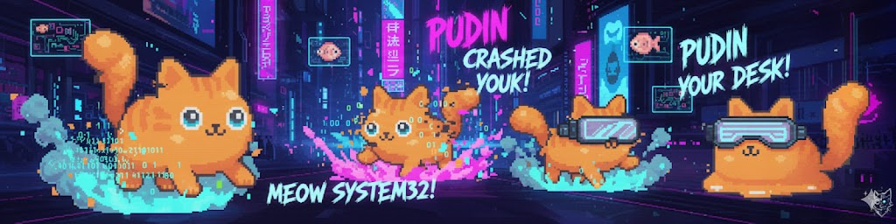
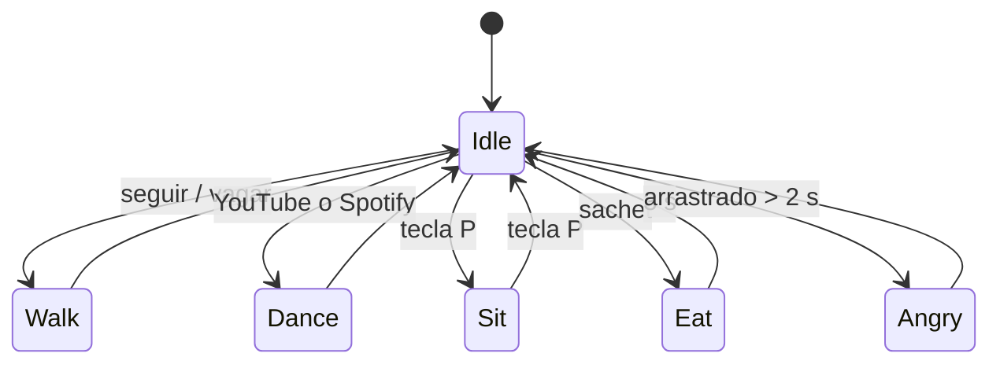

<h1 align="center">🐱 Pudin: The Ghost Cat RPA</h1>

<p align="center">
  <i>✨ Tu escritorio tiene un nuevo inquilino: pequeño, naranja y muy travieso ✨</i>
</p>

<p align="center">

</p>

<p align="center">
  <a href="https://youtu.be/UMO3PvRJNPc?si=m2oqhY35GSnm706P">
    
  </a>
</p>

<p align="center">
  
  
  
  
</p>

---

## 🍮 ¿Qué hace Pudin?

Vive en una ventana transparente encima de todo lo que tengas abierto y hace lo que quiere:

- 🐾 Te persigue el mouse y deja huellas de neón
- 🕺 Baila si detecta YouTube o Spotify
- 😈 Cada 30 a 90 s te hace una maldad en la ventana activa (más abajo el detalle)
- 🍅 Te marca un Pomodoro de 25/5 y, al terminar el trabajo, te manda un video (adivina cuál 👀)

Lo hice para aprender **Pygame** y la **API de Windows**. Nada serio, pero con cariño. 💖

---

## 🚀 Probarlo

```bash
git clone https://github.com/KaledSML/Pudin-Ghost-Cat-RPA.git
cd Pudin-Ghost-Cat-RPA/pudin_cat
pip install -r ../requirements.txt
python main.py
```

Necesitas **Windows** y Python 3. Ejecútalo desde la carpeta `pudin_cat` para que encuentre `assets/`.

<details>
<summary>📦 <b>Hacerlo .exe</b></summary>

<br>

```powershell
python -m PyInstaller --noconsole --onefile --add-data "assets;assets" --icon "assets/Pudin.ico" --name "Pudin_Ghost_Cat" main.py
```

</details>

<details>
<summary>🧪 <b>Probar las maldades sin esperar</b></summary>

<br>

```bash
python test_maldades.py
```

Aprieta `1` para lanzar una al azar. Actúan sobre la ventana activa, así que deja otra abierta para verlas.

</details>

---

## 🎮 Controles

| Input | Qué pasa |
| :---: | :--- |
| `F` o **clic derecho** | Dejas un sachet en tu cursor. Si Pudin se lo come, te regala **2 min sin maldades** 🍣 |
| **Clic izquierdo** sobre él | Lo arrastras. Si lo retienes más de 2 s se enoja y **te secuestra el mouse** por 3 a 5 s 😾 |
| `P` | Lo mandas a mimir 💤 (sin maldades hasta que vuelvas a apretar `P`) |
| `ESC` | Lo cierras 👋 |

---

## 🚨 Ojo con esto

Pudin no borra nada (lo de *System32* es un chiste 😸), pero sí **se mete con tu compu**:

- 🖼️ **Cambia tu fondo de pantalla** al abrir y **no lo devuelve** al cerrar. Guarda el tuyo antes.
- ⌨️ **Escribe por ti** en el Bloc de notas. Si cambias de ventana justo ahí, el texto cae donde estés.
- 🌐 **Abre YouTube** en tu navegador al terminar cada bloque de trabajo.

---

## 🔧 Por dentro

### Estados

Pudin es una máquina de estados con animación propia para cada uno. Cuando pasan varias cosas a la vez, gana el modo troll, luego el arrastre, luego la pausa, luego la comida. Si no pasa nada, cada 5 s elige entre seguirte, vagar o quedarse quieto.



### Maldades

| | Qué hace |
| :--- | :--- |
| 🫥 **Minimizar** | Esconde tu ventana |
| 🫨 **Sacudir** | La mueve 20 veces hasta ±25 px y la deja donde estaba |
| 👻 **Notepad fantasma** | Abre el Bloc de notas, hace clic y escribe una frase solito |

Corren en hilos aparte para que Pudin no se congele, y nunca lo atacan a él.

### Ventana transparente

Una ventana sin bordes del tamaño del monitor, pintada de un color (`255, 0, 128`) que Windows trata como transparente (`WS_EX_LAYERED` + color clave), siempre al frente. El mouse se lee con `pyautogui` y la ventana activa con `win32gui`.

### Archivos

| Archivo | Para qué |
| :--- | :--- |
| `main.py` | Ventana, bucle principal y controles |
| `pudin.py` | Estados, IA, Pomodoro y modo troll |
| `effects.py` | Huellas neón y partículas |
| `utils.py` | Sonidos, sprites, fondo de pantalla y maldades |
| `test_maldades.py` | Laboratorio de pruebas |

---

> [!WARNING]
> ### 🐾 AVISO DEL SISTEMA: [KaledSML](https://github.com/KaledSML)
>
> `Estado: Estable (a duras penas)`
> `Advertencia: Este código funciona por milagro. No lo toques o Pudin borrará tu System32.`
>
> **[> 🔓 DESBLOQUEAR APARIENCIA EXCLUSIVA "PUDIN_CYBERPUNK"](https://www.youtube.com/watch?v=dQw4w9WgXcQ)**

<p align="center">
  <sub>Hecho con 💖 por <a href="https://github.com/KaledSML"><b>Kaled San Martin Lastra</b></a> · Licencia <a href="LICENSE">MIT</a> · si Pudin te cae bien, regálale una ⭐</sub>
</p>
