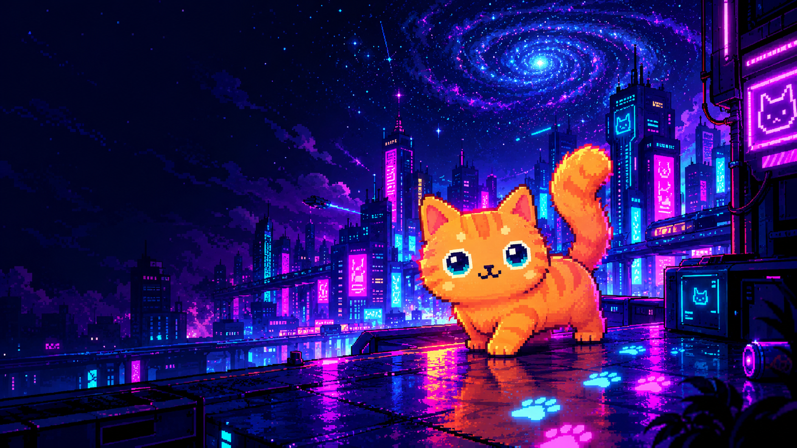

# 🐈‍⬛ Pudin.exe — The Ghost Cat RPA

<p align="center">
  
</p>

<p align="center">
  <strong>Un gatito fantasma naranja. Patitas de neón. Caos adorable para tu escritorio.</strong>
</p>

<p align="center">
  <a href="https://kaledsml.github.io/Pudin-Ghost-Cat-RPA/">🌐 Ver la landing</a>
  ·
  <a href="https://github.com/KaledSML/Pudin-Ghost-Cat-RPA">📦 Repositorio</a>
</p>

---

## ✨ ¿Qué es esta página?

Esta carpeta contiene la landing page de **Pudin.exe — The Ghost Cat RPA**, la puerta de entrada visual al proyecto Pudin. Combina una estética oscura de neón y glitch con información sobre el gatito, sus funciones, controles, instalación y material audiovisual.

La landing también esconde una pequeña sorpresa: al interactuar con el sachet flotante de la portada, puedes abrir un incidente paranormal protagonizado por Pudin. 👀

> **Importante:** esta documentación describe la página web y sus recursos. La aplicación de escritorio de Pudin es una parte distinta del proyecto y sus requisitos deben consultarse en la documentación principal del repositorio.

## 🗺️ Recorrido por la landing

- **Inicio:** presentación de Pudin, fondo animado y sachet interactivo.
- **Poderes:** resumen de las travesuras y funciones atribuidas al gatito.
- **Controles:** teclas y acciones para interactuar con Pudin.
- **Instalación:** comandos que muestra la página para instalar y ejecutar la aplicación del proyecto.
- **Archivo / transmisiones:** videos seleccionables y enlace a la lista de reproducción.
- **Galería:** imágenes y evidencia visual, con visor ampliado.
- **Incidente del sachet:** una escena secreta de terror retro que se activa desde el sachet de la portada.

## 🧩 Estructura de archivos

```text
docs/
├── index.html                 # Contenido y estructura de la landing
├── styles.css                 # Estilos, diseño adaptable y animaciones
├── script.js                  # Interacciones de la landing
├── sachet-incident.html       # Página secreta del incidente
├── sachet-incident.css        # Estilos de la experiencia secreta
├── sachet-incident.js         # Secuencia y controles del incidente
├── README.md                  # Esta documentación
└── assets/
    ├── Pudin.ico
    ├── pudin-banner.png
    ├── pudin_gif.gif
    ├── pudin_wallpaper.png
    ├── sachet.png
    └── pudin-incident/
        ├── comer.mp3
        ├── hiss.mp3
        ├── pudin-dance.png
        ├── pudin-jumpscare.png
        └── sachet.png

### ¿Qué hace cada archivo?

| Archivo | Función |
|---|---|
| `index.html` | Contiene las secciones, textos, enlaces y elementos de la landing. |
| `styles.css` | Define el tema visual oscuro, los neones, los efectos glitch, las animaciones y los ajustes para pantallas pequeñas. |
| `script.js` | Gestiona las interacciones de la página: copiar comandos, efectos de patitas, fondo Matrix, transmisiones, visor de imágenes y acceso al incidente secreto. |
| `sachet-incident.html` | Estructura las escenas de la experiencia secreta. |
| `sachet-incident.css` | Da forma a la estética de terror retro y sus efectos visuales. |
| `sachet-incident.js` | Controla la secuencia del incidente, los cambios de escena, los sonidos y el reinicio. |

## 🐾 Interacciones destacadas

La landing no es solo una página estática. Entre sus interacciones se encuentran:

- **Sachet flotante:** abre la experiencia secreta del incidente.
- **Comandos de instalación:** un botón permite copiar los comandos mostrados.
- **Patitas de neón:** un efecto visual acompaña el movimiento del cursor en dispositivos compatibles.
- **Fondo Matrix:** animación de fondo para reforzar la atmósfera digital.
- **Transmisiones:** permite seleccionar entre videos incrustados.
- **Galería:** abre las imágenes en un visor.
- **Accesibilidad y movimiento:** hay ajustes para pantallas pequeñas y para usuarios que prefieren reducir las animaciones.

La experiencia secreta pasa por una oferta del sachet, una transición con glitch, un jumpscare y un final. Incluye efectos de sonido y un botón para volver a empezar.

## 🖼️ Recursos visuales y de audio

Los recursos locales se guardan en `assets/`.

| Recurso | Uso |
|---|---|
| `Pudin.ico` | Icono del sitio. |
| `pudin-banner.png` | Imagen principal de Pudin. |
| `pudin_gif.gif` | GIF que aparece en la galería. |
| `pudin_wallpaper.png` | Imagen del fondo de escritorio mostrada en la galería. |
| `sachet.png` | Sachet interactivo de la portada. |
| `pudin-incident/sachet.png` | Sachet de la escena secreta. |
| `pudin-incident/hiss.mp3` | Sonido de la secuencia de terror. |
| `pudin-incident/comer.mp3` | Sonido del final del incidente. |
| `pudin-incident/pudin-jumpscare.png` | Imagen del jumpscare. |
| `pudin-incident/pudin-dance.png` | Sprite de baile de Pudin. |

Las rutas son relativas a `docs/`. Si renombras o mueves un recurso, actualiza también la ruta correspondiente en HTML, CSS o JavaScript.

## 🧪 Probar la página localmente

Puedes abrir `index.html` en un navegador para revisar la página. Para una prueba más fiel a la publicación, conviene servir la carpeta `docs/` mediante un servidor HTTP local, ya que algunos comportamientos del navegador pueden variar al abrir archivos directamente.

Por ejemplo, si tienes Python instalado, desde la raíz del repositorio ejecuta:

```bash
python -m http.server 8000 --directory docs
```

Luego abre en tu navegador:

```text
http://localhost:8000
```

Para revisar la experiencia secreta por separado:

```text
http://localhost:8000/sachet-incident.html
```

## 🚀 Publicación

La landing está publicada con GitHub Pages:

**https://kaledsml.github.io/Pudin-Ghost-Cat-RPA/**

La página vive dentro de `docs/`. Si la configuración de GitHub Pages del repositorio usa esa carpeta como fuente de publicación, los cambios en esos archivos se reflejarán tras publicar los commits correspondientes.

## 🛠️ Tecnologías y detalles

- **HTML** para la estructura del contenido.
- **CSS** para la identidad visual, las animaciones y el diseño adaptable.
- **JavaScript** para las interacciones del navegador.
- **Google Fonts** para la tipografía visual.
- **YouTube** para las transmisiones incrustadas.

La landing incluye una estética de terminal paranormal, colores neón, efectos glitch y referencias visuales a un archivo de experimentos. La página secreta usa una presentación de terror retro independiente.

## 💜 Créditos

Creado por **KaledSML**.

- [Repositorio de Pudin-Ghost-Cat-RPA](https://github.com/KaledSML/Pudin-Ghost-Cat-RPA)
- [Landing page de Pudin](https://kaledsml.github.io/Pudin-Ghost-Cat-RPA/)

---

<p align="center">
  <em>RPA: Retro Paranormal Activity. Si el sachet se mueve solo… probablemente es Pudin. 🐾</em>
</p>
